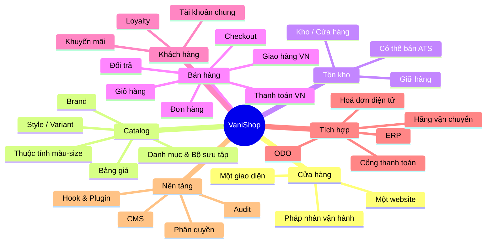

# Vision

> Trạng thái: **Designed**. Hiện trạng code: [status](status.md).

## 1. Bối cảnh

Owner kinh doanh thời trang với **nhiều thương hiệu** (ví dụ: công sở nữ, streetwear, trẻ em, phụ kiện). Hiện tại việc bán hàng có thể đang:

- Rải trên nhiều website/nền tảng khác nhau (Haravan, Sapo, WooCommerce…), dữ liệu phân mảnh.
- Bán thêm trên sàn (Shopee, Lazada, TikTok Shop) và cửa hàng vật lý với POS riêng.
- Quản lý tồn kho, kế toán trên ERP; điều phối đơn/giao nhận trên **ODO**.

Hệ quả: khách hàng bị tách, tồn kho không nhìn được toàn cục, đối soát COD và hoá đơn thủ công.

### 1.1 Vì sao có VaniShop thay cho VaniCommerce

Owner đang bán và viết plugin trên **VaniCommerce**, một nền tảng dẫn xuất từ BeikeShop. Lõi đó mang ràng buộc bản quyền (OSL-3.0 và điều khoản thương mại của bên giữ bản quyền — [clean-room-license §1](../01-principles/clean-room-license.md)): không tự do bán, đóng mã hay gỡ thông tin bản quyền. Vì mục đích **phát triển độc lập**, VaniShop ra đời làm **bản thay thế**, viết mới hoàn toàn theo quy trình clean-room, và giữ cách làm plugin **gần gũi** với người đã viết các plugin hiện có trong `VaniCommerce/plugins/`: plugin vẫn là thư mục tự chứa có manifest, cấu hình, màn hình Admin, khối storefront, bật/tắt độc lập, hook ngắn `vani_*`. Các plugin đó (của Owner) được chuyển sang bằng cách viết đặc tả rồi viết lại trên extension point của VaniShop ([ADR-034](../19-adr/ADR-034-vanicommerce-plugin-migration.md), [kế hoạch](../05-plugin/vanicommerce-plugin-migration.md)).

## 2. Tầm nhìn

> **Một cửa hàng — một website — một giao diện — nhiều thương hiệu trong cùng catalog — một khách hàng — một bức tranh tồn kho.**

VaniShop là **Commerce Kernel** của Owner, chạy **một cửa hàng** ([ADR-028](../19-adr/ADR-028-single-store-brand-as-catalog.md)). Thương hiệu là **nhóm sản phẩm** trong catalog: khách duyệt theo danh mục hoặc theo brand, cho sản phẩm của nhiều brand vào cùng một giỏ, thanh toán một lần.

| Nhu cầu | Cách đáp ứng |
|---|---|
| Một website, nhiều thương hiệu | Brand là thực thể Catalog: trang brand, bộ lọc, khuyến mãi theo brand ([store-and-brand](../12-store/store-and-brand.md)) |
| Fashion commerce | Core: mô hình Style → Màu → Size ([catalog-pricing](../03-domains/catalog-pricing.md)) |
| Native storefront và headless/API-first | Core: Storefront Application + API dùng chung catalog/giá/tồn ([storefront](../14-storefront/storefront.md)) |
| ERP và tích hợp ngoài | Core: Integration platform; connector là plugin |
| Nghiệp vụ riêng | Plugin qua Extension Points |

> **Core cung cấp commerce primitives và business invariants. Capability đặc thù nghiệp vụ được xây ngoài Core qua Extension Points.** Mục tiêu cuối cùng: một Commerce Kernel ổn định, extension point rõ ràng, plugin phát triển độc lập, nâng cấp an toàn, không fork Core.

Với Owner, điều đó có nghĩa là:

- **Một website** trên một domain, **một giao diện** (theme `vani-base` hoặc theme con), một bộ cấu hình, một pháp nhân đứng tên bán hàng.
- Thương hiệu có **trang riêng trong website** (`/thuong-hieu/{slug}`), logo, mô tả, bộ lọc; giá, khuyến mãi, tồn dùng chung cơ chế của cửa hàng.
- **Một tài khoản khách hàng**, loyalty chung, báo cáo hợp nhất (lọc được theo brand).
- Tồn kho **đa điểm** (kho tổng, cửa hàng) đồng bộ gần thời gian thực với ERP/ODO.
- Sẵn sàng **omnichannel** bằng plugin: BOPIS, ship-from-store, POS qua API/connector — đơn từ các nguồn này vào cùng luồng, ghi `source` để báo cáo.

## 2.1 Định hướng giai đoạn: bắt đầu từ SME, mở rộng khi doanh nghiệp lớn lên

> **VaniShop bắt đầu từ mô hình SME. Ưu tiên số một là vận hành tối ưu, dễ thao tác. Các điểm mở rộng cần thiết được giữ sẵn để bật khi doanh nghiệp phát triển — không xây trước giao diện hay quy trình của doanh nghiệp lớn.** (Owner, 2026-11-06)

Cửa hàng mục tiêu hiện tại là một shop thời trang SME: vài nhân viên kiêm nhiều việc (CSKH, đóng gói, đẩy đơn lên hãng vận chuyển), một kho, COD là chính, đơn từ kênh chat quản lý bằng Pancake, giao qua nhiều hãng nhập tay.

**Ba nguyên tắc:**

1. **Mặc định đơn giản cho SME.** Cài xong là chạy được với cấu hình mặc định. Tính năng của doanh nghiệp lớn không hiện ra khi chưa bật — vd. nhiều kho, chuyển kho, đối soát nguồn ngoài nằm trong plugin `vani.warehouse` ([ADR-042](../19-adr/ADR-042-inventory-warehouse-plugins.md)); Admin Core chỉ có "Kho chính".
2. **Vận hành trước tiên.** Màn hình Admin thiết kế theo công việc hằng ngày của nhân viên, không theo cấu trúc dữ liệu: hàng đợi việc có số đếm, thao tác ngay tại chỗ, thao tác hàng loạt, nút "bước tiếp theo", nhãn tiếng Việt thay cho mã kỹ thuật. Một việc lặp lại mỗi ngày phải làm được trên ít trang, ít bước nhất có thể.
3. **Giữ điểm mở rộng, không làm trước.** Chỉ giữ những điểm mở rộng mà doanh nghiệp sẽ cần khi lớn lên (contract, slot, plugin, schema chừa chỗ). Khi phải chọn giữa "đủ cho SME, dễ dùng" và "đầy đủ cho doanh nghiệp lớn": chọn dễ dùng, để sẵn điểm mở rộng, ghi phần còn thiếu vào backlog ([§6b](../20-roadmap/reference-parity-refactor.md)).

| Mảng | Giai đoạn SME (hiện tại) | Khi doanh nghiệp lớn lên — mở bằng |
|---|---|---|
| Kho | Một "Kho chính", sửa tồn trên lưới, nhập CSV | Plugin `vani.warehouse`: nhiều kho, chuyển kho, đối soát; ERP qua Integration API |
| Đơn hàng | Nhân viên xử lý trên Admin theo hàng đợi việc; đơn kênh chat ở Pancake | Integration API v1 (đồng bộ đơn, ERP/ODO) |
| Xác nhận COD | Cấu hình: tự xác nhận mọi đơn / chỉ khách quen / gọi xác nhận (`vani.cod`) | Rule riêng bằng plugin nghe `OrderPlaced` |
| Giao hàng | Nhân viên đẩy đơn lên nhiều hãng, web ghi mã vận đơn và trạng thái | Plugin hãng (`ShippingCarrier`): tự đặt vận đơn, webhook trạng thái |
| Ngôn ngữ, tiền tệ | Tiếng Việt, VND | Bật `VANI_LOCALES`, cột `currency` đã có ([§4](#4-không-nằm-trong-phạm-vi-non-goals)) |
| Báo cáo | Báo cáo cơ bản trong Admin | Plugin báo cáo, dữ liệu sang ERP |

## 3. Mục tiêu (Goals)

| # | Mục tiêu | Đo lường |
|---|---|---|
| G1 | Một cửa hàng nhiều thương hiệu | Thêm brand mới = tạo brand trong Catalog + gán sản phẩm, không cần deploy, trong ngày |
| G2 | Single customer view | 100% đơn web gắn với 1 hồ sơ khách hàng hợp nhất |
| G3 | Tồn kho chính xác | Chênh lệch tồn web vs ERP < 0,5%; oversell < 0,1% đơn |
| G4 | Tích hợp tự động qua module Integration | ≥ 99% message tới hệ thống ngoài (ERP, ODO khi có) không cần can thiệp tay; độ trễ P95 < 60 giây |
| G5 | Phù hợp thị trường VN | Hỗ trợ COD, VietQR, ví điện tử, hoá đơn điện tử, địa chỉ 2 cấp mới |
| G6 | Hiệu năng | TTFB storefront P95 < 300 ms (cache nóng), LCP mobile < 2,5 s |
| G7 | Pháp lý | Tuân thủ quy định TMĐT, bảo vệ dữ liệu cá nhân, hoá đơn điện tử |
| G8 | Vận hành dễ thao tác cho SME ([§2.1](#21-định-hướng-giai-đoạn-bắt-đầu-từ-sme-mở-rộng-khi-doanh-nghiệp-lớn-lên)) | Một đơn COD thường đi từ "Cần xác nhận" tới "Đang giao" chỉ trên danh sách đơn + trang đơn, không mở trang khác; việc lặp lại hằng ngày (xác nhận, tạo vận đơn, bàn giao) có thao tác hàng loạt; nhân viên mới tự xử lý đơn trong ngày đầu |

## 4. Không nằm trong phạm vi (Non-goals)

- Danh sách hạng mục **không phải mục tiêu của dự án** (không hoãn, không đóng băng): [ADR-033](../19-adr/ADR-033-out-of-scope.md). Không thiết kế, không plugin, không extension point chuẩn bị cho chúng.
- **Không** làm SaaS cho khách hàng khác (một bản cài đặt = một Owner).
- **Không** thay thế ERP (kế toán, giá vốn, mua hàng, sản xuất) hay ODO (vận hành kho, pick–pack, điều phối vận chuyển).
- **Không** tự xây POS (POS hiện hữu tích hợp qua API; POS riêng là tuỳ chọn về sau).
- **Không** hỗ trợ bán xuyên biên giới / đa tiền tệ ở giai đoạn đầu (thiết kế schema vẫn chừa chỗ).
- Hiện cửa hàng **chỉ tiếng Việt, chỉ VND** (Owner 2026-11-05). Cơ chế đa ngôn ngữ (`VANI_LOCALES`, bản dịch, URL theo ngôn ngữ — [ADR-038](../19-adr/ADR-038-localized-storefront-urls.md)) và tiền tệ trong dữ liệu (`currency`, [ADR-011](../19-adr/ADR-011-money-representation.md)) được giữ và có test, để mở sau mà không đổi schema.

## 5. Các bên liên quan (Stakeholders)

| Vai trò | Nhu cầu chính |
|---|---|
| Ban điều hành Owner | Báo cáo hợp nhất, lọc theo brand/danh mục/nguồn đơn/cửa hàng vật lý |
| Quản lý ngành hàng | Catalog, giá, khuyến mãi, nội dung; theo dõi hiệu quả từng brand |
| E-commerce / Merchandiser | Sắp xếp danh mục, bộ sưu tập, landing page, SEO |
| CSKH | Tra cứu đơn/khách, xử lý đổi trả |
| Vận hành kho / ODO | Nhận đơn chuẩn hoá, trả trạng thái giao nhận (vai trò ODO tạm hoãn — [ADR-007](../19-adr/ADR-007-erp-integration.md)) |
| Kế toán / ERP | Đối soát thanh toán, COD, hoá đơn điện tử, doanh thu (theo brand khi cần) |
| Cửa hàng vật lý | Nhận đơn BOPIS, ship-from-store, đổi trả hàng mua online |
| Khách hàng cuối | Mua nhanh trên mobile, thanh toán quen thuộc, theo dõi đơn, đổi trả dễ |
| Đội IT | Hệ thống dễ bảo trì, test được, mở rộng được |

## 6. Phạm vi chức năng tổng quát

## 7. Nguyên tắc định hướng

1. **SME trước, vận hành trước** ([§2.1](#21-định-hướng-giai-đoạn-bắt-đầu-từ-sme-mở-rộng-khi-doanh-nghiệp-lớn-lên)): mặc định đơn giản cho cửa hàng nhỏ, Admin theo công việc hằng ngày, điểm mở rộng giữ sẵn cho lúc doanh nghiệp lớn — không làm trước.
2. **Clean-room tuyệt đối**: không copy mã, schema, asset, file ngôn ngữ từ BeikeShop. Chỉ học ý tưởng ở mức khái niệm.
3. **Một cửa hàng, không phân mảnh**: dữ liệu nghiệp vụ ở cấp cửa hàng; brand là thuộc tính catalog để duyệt/lọc/báo cáo, không phải ranh giới dữ liệu ([ADR-028](../19-adr/ADR-028-single-store-brand-as-catalog.md)).
4. **Authority dữ liệu rõ ràng** cho từng loại dữ liệu, xem ma trận trong [erp-integration](../11-integration/erp-integration.md).
5. **Tích hợp bất đồng bộ, idempotent**: không để lỗi ERP/ODO làm hỏng checkout.
6. **Core tối giản, nghiệp vụ bằng plugin** ([commerce-kernel](../02-architecture/commerce-kernel.md)): Core chỉ gồm primitives, invariants và extension points.
7. **Modular monolith**: ranh giới module rõ ràng trong một ứng dụng, không tách service chạy riêng ([ADR-033](../19-adr/ADR-033-out-of-scope.md)).
8. **Mobile-first, Việt Nam-first**: VNĐ, tiếng Việt có dấu, COD, địa chỉ mới.
9. **Test là một phần của tính năng**: không merge nếu thiếu test cho nghiệp vụ lõi.
10. **Tài liệu phản ánh implementation**: trạng thái thật nằm ở [status](status.md). Các quy tắc bắt buộc nằm ở [architecture-rules](../01-principles/architecture-rules.md).
