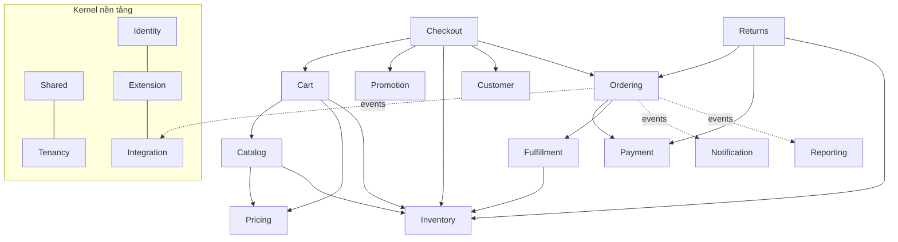

# Bounded Contexts

> Trạng thái: **Partially Implemented**. Bảng này mô tả các bounded context hiện có trong code. Theo [ADR-028](../19-adr/ADR-028-single-store-brand-as-catalog.md), không còn context/module **Brand** hay **Channel**; brand là thực thể của **Catalog**.
>
> Bảng gồm cả module Core và capability do plugin sở hữu; các dòng ghi rõ plugin không thuộc danh sách 18 module Core.

## 1. Danh sách context

| Context | Sở hữu (dữ liệu, quy tắc) | Không sở hữu | Contract công bố chính |
|---|---|---|---|
| **Shared** | `Money`, `Currency`, `Phone`, `Address` VO, `CurrentContext`, địa giới hành chính VN, `CorrelationId` | Nghiệp vụ | — (kernel dùng chung) |
| **Tenancy** (cửa hàng) | Thông tin cửa hàng + pháp nhân vận hành, theme tokens cấp cửa hàng, settings một cấp | Catalog | `Settings`, `LegalEntityDirectory` |
| **Identity & Access** | Nhân viên, vai trò, permission (`owner`/`location`), audit log | Khách hàng | `Authorizer`, `AuditLogger` |
| **Extension** | Hook registry, plugin loader, manifest, trạng thái plugin, settings schema | Nghiệp vụ plugin | `Hook`, `PluginRegistry` |
| **Catalog** | **Brand**, style, style color, variant/SKU, thuộc tính, danh mục, bộ sưu tập, media, nội dung | Giá, tồn | `CatalogReader`, `VariantDirectory` |
| **Pricing** | Bảng giá, giá theo variant, lịch giá, lịch sử giá, `PricingStrategy` | Khuyến mãi | `PriceResolver` |
| **Inventory** | Location, stock level, reservation, movement/ledger, ATS | Chọn kho cho đơn (thuộc Fulfillment) | `InventoryReservation`, `InventoryAdjuster`, `AvailabilityReader` |
| **Customer** | Tài khoản hợp nhất, địa chỉ, nhóm khách, consent, xác thực khách | Loyalty | `CustomerDirectory` |
| **Cart** | Giỏ, dòng giỏ, gộp giỏ, snapshot giá khi thêm | Tính tổng cuối cùng | `Carts` |
| **Checkout** | Phiên checkout, totals pipeline, `PlaceOrder` (điều phối) | Đơn sau khi tạo | `TotalsCalculator` (extension), `CheckoutValidator` (extension) |
| **Promotion** | Framework khuyến mãi: context, rule/action contract, đánh giá, stacking, ghi nhận sử dụng | Rule cụ thể (thuộc plugin) | `PromotionRule`, `PromotionAction` |
| **Ordering** | Order, order line (snapshot, gồm brand), state machine, sự kiện đơn, nguồn đơn | Thanh toán, giao hàng | `OrderWriter` (**Implemented**), `OrderReader`, `OrderTransitions` |
| **Payment** | Payment, transaction, refund, khung gateway, COD, chuyển khoản thủ công | Đối soát COD chi tiết (plugin) | `PaymentGateway` (extension), `PaymentRecorder` |
| **Fulfillment** | Shipment, sourcing, fulfillment method, carrier abstraction, vận đơn thủ công | Tồn | `ShippingCarrier`, `SourcingStrategy`, `FulfillmentMethod`, `ShipmentRecorder` |
| **Returns** | Yêu cầu đổi/trả, kiểm hàng, quyết định hoàn | Hoàn tiền (gọi Payment) | `ReturnPolicy` |
| **Content** (plugin `vani.cms`) | Trang, bài viết, chuyên mục, banner và nội dung thêm | Core commerce data | `StorefrontBlock`, `LinkType`, `SitemapProvider` |
| **Notification** | Template theo loại tin × kênh gửi × locale, gửi tin, nhật ký gửi | Nội dung marketing | `NotificationChannel` |
| **Reporting** → plugin `vani.reports` ([ADR-029](../19-adr/ADR-029-commerce-microkernel.md)) | Read model báo cáo, dashboard | Dữ liệu gốc | Core chỉ cung cấp `DashboardWidget` + slot dashboard |
| **Integration** | Integration Client, API, webhook, outbox/inbox, mapping, ownership, connector framework | Nghiệp vụ domain | `Connector`, `IntegrationOutbox`, `ErpConnector` |
| **Storefront** | Không có dữ liệu riêng: ghép Catalog + Pricing (+ Inventory, Promotion…) cho Storefront API và native storefront ([ADR-021](../19-adr/ADR-021-storefront-composition-module.md)) | Mọi dữ liệu nghiệp vụ | `ProductViews` (nội bộ) |

## 2. Context map



Mũi tên liền nghĩa là **gọi đồng bộ qua Contract** (downstream phụ thuộc upstream). Mũi tên đứt nghĩa là **lắng nghe Domain Event**. Không có vòng phụ thuộc: nếu hai context cần nhau thì một chiều đi qua event.

## 3. Quan hệ giữa các context

| Quan hệ | Kiểu | Ghi chú |
|---|---|---|
| Checkout → Inventory | Customer/Supplier, đồng bộ | `reserve()` trong transaction đặt hàng |
| Checkout → Ordering | Đồng bộ | `CreateOrder` trong cùng transaction; Checkout điều phối |
| Ordering → Payment/Fulfillment | Event + Contract | Payment/Fulfillment cập nhật trạng thái qua `OrderTransitions` |
| Integration → mọi context | Anti-Corruption Layer | Payload canonical có version; không lộ model nội bộ ra ngoài |
| Plugin → Core | Conformist với Contract | Plugin tuân theo contract; Core không biết plugin |

## 4. Cấu trúc một module (pragmatic DDD)

```
modules/Inventory/
├── Contracts/          # PUBLIC: interface + DTO cho module khác & plugin
│   ├── InventoryReservation.php
│   └── Data/ReservationRequest.php
├── Events/             # PUBLIC: domain events (DTO bất biến)
│   └── StockReserved.php
├── Domain/             # PRIVATE: VO, enum, entity thuần, domain service, invariant — không dùng Eloquent/Facade
│   ├── StockLevel.php            # quy tắc ATS, reserve/release thuần PHP
│   ├── ReservationStatus.php
│   └── Exceptions/InsufficientStock.php
├── Application/        # PRIVATE: use case (Command/Action), Query, DTO nội bộ, transaction boundary
│   ├── Commands/ReserveStock.php
│   ├── Queries/GetAvailability.php
│   └── Services/ReservationService.php   # implements Contracts\InventoryReservation
├── Persistence/        # PRIVATE: Eloquent model, repository, migration, factory, seeder
│   ├── Models/StockLevelRecord.php
│   ├── Repositories/EloquentStockLevelRepository.php
│   └── Database/{migrations,Factories,Seeders}/
├── Infrastructure/     # PRIVATE: adapter hạ tầng (Redis counter, queue job, HTTP client nếu có)
├── Http/               # Controller, Form Request, API Resource, routes
│   ├── Controllers/{Storefront,Admin,Api}/
│   ├── Requests/  Resources/
│   └── routes/{storefront,admin,api}.php
├── Policies/           # Laravel Policy (phân quyền theo scope)
├── resources/{views,lang,js/Pages}/
├── hooks.php           # Khai báo hook công khai của module
├── Tests/{Unit,Feature}/
└── InventoryServiceProvider.php
```

### Quy tắc phụ thuộc trong module

```text
Http ──► Application ──► Domain
              │             ▲
              ▼             │
        Persistence ────────┘ (map record ↔ domain)
        Infrastructure
```

- `Domain` không phụ thuộc gì ngoài `Modules\Shared\Domain` (rule R8).
- `Application` là **transaction boundary**: mỗi Command handler mở tối đa một transaction.
- Module khác và plugin chỉ thấy `Contracts/` và `Events/` (rule R5, R7).

### Hai mức độ "giàu" của domain

Để tránh over-engineering, mỗi context chọn một mức, ghi rõ trong `modules/<Module>/README.md` (có từ 0.5.8, arch test D5 giữ phần bảng sở hữu khớp migration):

| Mức | Context | Cách làm |
|---|---|---|
| **Rich domain** | Inventory, Ordering (state machine), Pricing, Promotion, Payment (máy trạng thái + luật hoàn tiền/COD, 0.5.4), Returns (giới hạn trả, tiến độ, giá trị đổi hàng, 0.5.5), Fulfillment (máy trạng thái vận đơn, đối chiếu phân bổ, COD theo vận đơn, 0.5.6) (quy tắc hiện còn nằm trong Application service — [architecture-consolidation D1–D3](../20-roadmap/architecture-consolidation.md)) | Quy tắc nằm trong `Domain/` thuần PHP, test unit không cần DB. Eloquent chỉ lưu trữ |
| **Điều phối** | Checkout (ghép giỏ, giá, khuyến mãi, thuế, phí giao; phép tính tiền dùng `Shared\Domain\Money`), Storefront (tầng ghép, không có bảng) | Application gọi contract các module khác; không có `Domain/` riêng |
| **CRUD domain** | Content, Notification (template), cấu hình cửa hàng, brand và thuộc tính Catalog | Application dùng Eloquent trực tiếp qua Persistence; vẫn không có logic trong Controller |

## 5. Đăng ký module

`App\Providers\ModuleServiceProvider` đọc `config/modules.php` (danh sách module theo thứ tự phụ thuộc) rồi đăng ký `<Context>ServiceProvider` của từng module. Service provider của module nạp route, migration, view, lang, trang Inertia, hooks.php và bind các Contract.

```php
// config/modules.php (2026-11-17) — upstream trước; Content và Reporting đã là plugin (vani.cms, vani.reports)
return [
    'Shared', 'Tenancy', 'Identity', 'Extension',
    'Catalog', 'Pricing', 'Inventory', 'Cart', 'Promotion', 'Ordering', 'Customer',
    'Payment', 'Checkout', 'Fulfillment', 'Returns', 'Notification', 'Integration', 'Storefront',
];
```

Thứ tự này là hướng phụ thuộc: module chỉ nên dùng `Contracts` của module đứng trước (nghe `Events` thì từ module nào cũng được). Giữ bằng `tests/Architecture/ModuleBoundaryTest.php` (từ 0.5.0; không còn nợ từ 0.5.3). Với vòng 0, module thương mại dùng được toàn bộ `Shared` (shared kernel); của Identity/Extension/Tenancy chỉ dùng `Contracts`, `Events`, `Facades`, `Domain` (value type) — test C1.

## 6. Kiểm thử ranh giới

Chi tiết: [testing §5](../17-testing/testing.md). Tối thiểu có các arch test sau:

```php
arch('core không phụ thuộc plugin')->expect('Modules')->not->toUse('Plugin');
arch('domain thuần')->expect('Modules\*\Domain')->not->toUse(['Illuminate\Database', 'Illuminate\Support\Facades', 'Illuminate\Http']);
arch('ordering không dùng persistence của inventory')->expect('Modules\Ordering')->not->toUse('Modules\Inventory\Persistence');
```
