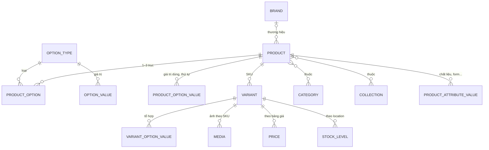

# Catalog & Pricing

> Trạng thái: **Partially Implemented** (slice 1). Context: Catalog, Pricing ([bounded-contexts](../02-architecture/bounded-contexts.md)).
>
> **Định hướng [ADR-028](../19-adr/ADR-028-single-store-brand-as-catalog.md)**: một catalog cho cả cửa hàng; **brand là thực thể của Catalog** (§1.1). Cột "Trạng thái" dưới đây mô tả code hiện tại (sau slice 12, 2026-10-02).
>
> | Phần | Trạng thái |
> |---|---|
> | Brand là thực thể catalog (`brands`, `products.brand_id` tuỳ chọn), Admin `/catalog/brands`, Storefront API `/brands` + lọc/facet `brand`, snapshot trên dòng đơn | Implemented (bản dịch brand: Planned; trang native `/thuong-hieu/{slug}`: slice 12b) |
> | Danh mục (một cây cho cả cửa hàng): `parent_id` + materialized `path` (`/12/57/`), tối đa **5 cấp**, di chuyển kéo theo cả cây con, chặn chuyển vào cây con của chính nó, không xoá danh mục còn con, `lock_version`, bản dịch vi/en + SEO, ảnh | Implemented |
> | Thuộc tính spec/internal, kiểu `select`/`multiselect`/`text`/`boolean`, giá trị có bản dịch; sửa giá trị giữ nguyên id theo `code` | Implemented |
> | Loại tuỳ chọn biến thể dùng chung ([ADR-045](../19-adr/ADR-045-flexible-variant-options.md), 0.4.25–0.4.28): Màu, Size là hai loại có sẵn, thêm được Chất liệu, Dung tích…; mỗi sản phẩm 1–3 trục; ảnh theo SKU; lọc danh mục `opt[<mã>]`; giỏ/đơn chụp `variant_options` | Implemented |
> | Media: thư viện dùng chung, khử trùng lặp theo SHA-256 + `mediables` (gắn đa hình theo `role`); disk `VANI_MEDIA_DISK` | Implemented |
> | Thư viện ảnh dùng chung `/{admin}/media` (2026-10-08): thư mục ảo `media_folders` + `media.folder` (slug, lồng tối đa 4 cấp, đổi tên kéo theo con, chỉ xoá thư mục rỗng), tải lên/kéo thả (jpg/png/webp ≤ 10 MB, 20 ảnh/lần), tìm theo tên mọi thư mục, sắp xếp, đổi tên hiển thị, chuyển thư mục, xoá chỉ ảnh không còn dùng (kèm file gốc + bản thu nhỏ). Modal chọn ảnh `MediaPicker` (`resources/js/admin/Components/Media`) ở ảnh SKU và ảnh danh mục. Quyền `media.view` (xem/chọn), `media.manage` (ghi) | Implemented |
> | Product (mã `product_code`, slug, trạng thái, khung giờ hiển thị, bản dịch, danh mục + danh mục chính, thuộc tính), bộ sưu tập thủ công. Tên bảng/model `Style` đổi thành `Product` ở 0.5.89 ([ADR-050](../19-adr/ADR-050-product-replaces-style.md)) | Implemented (slice 2) |
> | Tìm kiếm: `ProductSearch` (truy vấn SQL — tìm không dấu qua `products.search_text`, lọc danh mục gồm danh mục con, loại tuỳ chọn biến thể, thuộc tính, giá; facet). Dự án chỉ tìm bằng SQL: plugin `vani.search-meilisearch` gỡ 2026-11-12, extension point `SearchProvider` + `vani:search:reindex` gỡ ở 0.5.63. Đo 10.000 sản phẩm / 50.000 SKU: 5–16 ms mỗi truy vấn.
> | **Nhập/xuất file sản phẩm** (mỗi SKU một dòng, xem trước rồi áp dụng): xuất 10.000 sản phẩm / 50.000 SKU ≈ 6 s, số truy vấn không tăng theo số sản phẩm; nhập tối đa `ProductFile::MAX_ROWS` = 60.000 dòng (file tới 20 MB) — xem trước 50.000 dòng ≈ 3 s; quá 200 sản phẩm ghi được thì áp dụng **chạy nền** theo lô 100 sản phẩm (`ApplyProductImportChunkJob`, `Shared\Support\BulkRun`, cần queue worker `default`), trang danh sách hiện tiến độ và lỗi (0.5.63).
> | Variant/SKU (tổ hợp giá trị tuỳ chọn, SKU/barcode duy nhất, sinh ma trận), bảng giá cấp cửa hàng (có thể gắn nhóm khách), `PricingStrategy` `price_list_priority`, `price_history` | Implemented (slice 3) |
> | Giá thành viên theo nhóm khách (0.3.35): bảng giá gắn `customer_group_id` (loại `member` bắt buộc), `PricingContext.customerId` → `PriceResolver` tự tra nhóm qua `Pricing\Contracts\CustomerGroupDirectory` (module Customer cung cấp); giỏ/checkout của khách đăng nhập tính giá nhóm; trang công khai (cache) hiện giá chung, giá thành viên qua `GET /api/storefront/v1/me/prices` (JS của theme gọi bằng phiên cùng nguồn, ADR-044) | Implemented |
> | Giá theo số lượng, import Excel giá | Designed |
> | Bộ sưu tập theo luật, merchandising ghim vị trí trong Admin | Designed |
> | Resize ảnh: bản thu nhỏ tạo khi có request đầu tiên, cache tại `public/cache` (`ImageCache`, 0.3.28); WebP qua plugin `vani.media-webp`; kích thước cấu hình ở Admin (tỉ lệ ảnh sản phẩm mặc định 2:3, kích thước có tên của plugin qua `ImageSizeProvider` — 0.3.87); ô chọn ảnh dùng chung `MediaField` | Implemented |

## 1. Mô hình sản phẩm

Sản phẩm có 1–3 trục tuỳ chọn chọn từ danh mục loại dùng chung ([ADR-045](../19-adr/ADR-045-flexible-variant-options.md)); SKU là một tổ hợp giá trị. Thời trang dùng hai trục Màu × Size; hàng khác dùng trục khác (Dung tích, Chất liệu) hoặc một SKU không trục.



| Thực thể | Định nghĩa | Ví dụ |
|---|---|---|
| **Product** (sản phẩm, mẫu) | Sản phẩm mà khách nhìn thấy, 1 trang PDP. Mã `product_code` (bảng `products`) | `LM24FW-SH012` Áo sơ mi lụa |
| **Option type / value** | Loại tuỳ chọn dùng chung và giá trị của nó; sản phẩm chọn 1–3 loại làm trục | Màu: Trắng ngà; Size: M |
| **Variant (SKU)** | Đơn vị bán & tồn kho nhỏ nhất = một tổ hợp giá trị (`variants.option_key`). Có `sku`, `barcode` (EAN/GTIN), ảnh riêng | `LM24FW-SH012-IVR-M` |
| **Brand** | Thương hiệu của sản phẩm (tuỳ chọn); có trang riêng, logo, mô tả, SEO | Lumière, Urbanx |
| **Size Chart** | Bảng size theo loại hàng, có thể riêng theo brand (plugin `vani.size-chart`) | Bảng size áo nữ Lumière |

- Sản phẩm **không có biến thể** (túi, phụ kiện) có 0 trục và 1 SKU.
- **Bundle / set** (set áo + quần): plugin `vani.bundles` (combo = danh sách sản phẩm + số lượng).
- Trạng thái sản phẩm: `draft` → `active` → `archived`; lịch hiển thị `published_from/to`.

### 1.1 Brand

Brand là nhóm sản phẩm theo thương hiệu, **không** là phạm vi dữ liệu ([ADR-028](../19-adr/ADR-028-single-store-brand-as-catalog.md)):

- `brands(code, slug, name, description, logo_path, meta_title, meta_description, status, position)`; `products.brand_id` (nullable, `RESTRICT`). Bản dịch brand: Planned.
- Dùng cho trang `/thuong-hieu/{slug}`, facet tìm kiếm, menu, rule khuyến mãi "thuộc brand", báo cáo, snapshot trên dòng đơn.
- Không ảnh hưởng giá, tồn, quyền, cấu hình. Ẩn brand chỉ ẩn trang brand, không ẩn sản phẩm.

## 2. Thuộc tính

| Loại | Dùng cho | Ví dụ |
|---|---|---|
| **Option axis** (loại tuỳ chọn, ADR-045) | Tạo variant — 1–3 trục mỗi sản phẩm | Màu, Size, Chất liệu, Dung tích |
| **Spec attribute** | Hiển thị + lọc | Chất liệu, Form dáng, Cổ áo, Độ dày, Mùa |
| **Internal attribute** | Vận hành, không hiển thị | Nhà cung cấp, Mã ERP, Nhóm thuế |

- **Loại tuỳ chọn** (`option_types`): mã, tên theo ngôn ngữ, kiểu hiển thị (`swatch` ô màu | `button` nút | `dropdown` danh sách), "lọc được" ở danh mục, thứ tự. Giá trị (`option_values`): mã, tên theo ngôn ngữ, thứ tự, `group` (vd. hệ size VN/US/EU, chữ/số) và — với loại ô màu — `hex` + `family` (nhóm lọc chuẩn: Trắng, Đen, Be, Xanh…; "Trắng ngà" thuộc nhóm Trắng).
- **Màu** (`color`, ô màu) và **Size** (`size`, nút) là hai loại có sẵn; sản phẩm không có màu/size (phụ kiện một cỡ, mỹ phẩm theo dung tích) chọn loại khác hoặc một trục.
- Sản phẩm chọn 1–3 loại làm trục (`product_options`) và giá trị dùng, có thứ tự riêng (`product_option_values`); SKU là một tổ hợp giá trị (`variant_option_values`, khoá `variants.option_key`). Ảnh gắn theo SKU (áp một bộ ảnh cho mọi SKU cùng màu bằng một nút).
- Thuộc tính và loại tuỳ chọn khai báo **một lần cho cả cửa hàng** (Admin → Catalog → Tuỳ chọn biến thể).

## 3. Danh mục, bộ sưu tập, merchandising

- **Category**: **một cây** cho cả cửa hàng (dùng `parent_id` + đường dẫn materialized `path`), chứa sản phẩm của mọi brand. Duyệt theo brand dùng trang brand + bộ lọc, không dùng cây riêng.
- **Collection**: tập hợp **thủ công** hoặc **theo luật** (ví dụ: `season = FW24 AND tag = best-seller`), dùng cho landing page, campaign.
- **Merchandising**: ghim vị trí sản phẩm, sắp xếp theo doanh số/tồn/mới; ẩn sản phẩm hết size chủ lực.
- **Taxonomy Google/Meta**: ánh xạ category → `google_product_category` để xuất feed quảng cáo.

## 4. Nội dung & media

- Nội dung dịch được (tên, mô tả, hướng dẫn giặt, SEO) lưu `product_translations(locale, ...)`.
- Media lưu trên S3; bảng `media` đa hình qua `mediables` (SKU, danh mục, banner). Có `alt`, `sort_order`, `role` (`main`, `hover`, `lookbook`, `video`).
- Ảnh phục vụ qua CDN có resize theo tham số (`w`, `h`, `fit`, `format=webp/avif`).
- Khuyến nghị chuẩn ảnh: 4:5, ≥ 1600px cạnh dài.

## 5. Mã hàng & đồng bộ với ERP

- **ERP là nguồn gốc của mã hàng** (`sku`, `barcode`, đơn vị, nhóm hàng, giá vốn) — xem ma trận ở [integration-platform](../11-integration/integration-platform.md).
- **VaniShop là nguồn gốc của nội dung bán hàng** (tên hiển thị, mô tả, ảnh, danh mục, SEO).
- Luồng: ERP tạo item → module Integration nhận → tạo/cập nhật variant ở trạng thái `draft` + gom thành sản phẩm theo `product_code` → merchandiser bổ sung nội dung → `active`.
- Bảng `external_references(entity_type, entity_id, system, external_id)` lưu ánh xạ mã giữa hệ thống.

## 6. Giá (Pricing)

### 6.1 Mô hình

```
price_lists(id, code, currency_code, type[base|sale|member], customer_group_id NULL, priority, starts_at, ends_at, active)
prices(price_list_id, variant_id, amount, compare_at_amount, min_qty)
```

- **Giá niêm yết** (`compare_at_amount`) và **giá bán** (`amount`). Hiển thị "giảm x%" chỉ khi giá bán < giá niêm yết.
- Giá tính theo **variant**; có thể nhập nhanh theo sản phẩm/màu (áp cho mọi size).
- Chọn giá (**Implemented**, `Modules\Pricing\Domain\PriceSelection`): lọc bảng giá đang bật và trong khung giờ, áp dụng điều kiện nhóm khách nếu có → bảng giá `priority` cao nhất thắng → cùng priority lấy **giá thấp nhất** → vẫn trùng lấy id nhỏ hơn. Giá gốc: `compare_at` của mức thắng nếu lớn hơn giá bán; nếu mức thắng không phải bảng `base` thì dùng giá `base` cao nhất lớn hơn giá bán. `% giảm` làm tròn **xuống** (không phóng đại mức giảm).
- Tiền theo [money](../02-architecture/money.md).
- Cách chọn giá là extension point:

```php
interface PricingStrategy
{
    public function code(): string;                     // mặc định 'price_list_priority'
    public function resolve(VariantId $variant, PricingContext $ctx): ResolvedPrice;  // amount + compare_at + nguồn bảng giá
}
```

Core dùng strategy được cấu hình cho cửa hàng; giá trả về vẫn là `Money` và được snapshot vào đơn.
- Giá **đã bao gồm VAT** (thói quen B2C tại VN); lưu `tax_class` để tách thuế khi xuất hoá đơn.

### 6.1a Thao tác Admin (0.4.55–0.4.57)

- **Một bảng giá niêm yết** (mã `base`): giá bán thường, sửa ở sản phẩm (form/ma trận, sửa trong ô và "Đổi giá" ở danh sách sản phẩm); trang bảng giá chỉ xem. Bảng sale/thành viên tạo bằng Loại + Tên + khung giờ (mã, độ ưu tiên tự sinh).
- **Trang làm việc của bảng giá**: mọi SKU trong bảng, sửa trong ô, chọn nhiều → áp giá (giảm %, giảm số tiền, đồng giá — tính từ giá niêm yết, làm tròn 1.000đ, có xem trước) hoặc gỡ; thêm sản phẩm (tìm theo tên/mã/SKU) hoặc "Đưa vào bảng giá…" từ danh sách sản phẩm; xuất/nhập file.
- Cảnh báo **không chặn** (giá sale được về 0đ — Owner 2026-11-15): 0đ, không thấp hơn giá niêm yết, giảm vượt mức trần khuyến mãi của cửa hàng, chưa có giá niêm yết.

### 6.2 Lịch sử giá & tuân thủ

- Ghi `price_history` mỗi lần đổi giá (ai, khi nào, giá cũ/mới) — phục vụ kiểm tra khuyến mãi theo quy định (giá trước khuyến mãi phải là giá thực tế đã bán).
- Giá do ERP đẩy về (nếu ERP làm master giá) hay nhập ở VaniShop là **cấu hình của cửa hàng**.

## 7. Tìm kiếm & lọc

- Một index cho cửa hàng (`products`), document = sản phẩm.
- Trường tìm: tên (có dấu + không dấu), mã, **brand**, màu, chất liệu, danh mục.
- Facet: danh mục, **brand**, color_family, size **còn hàng**, khoảng giá, chất liệu, bộ sưu tập.
- Đồng bộ index qua event `ProductUpdated`, `PriceChanged`, `AvailabilityChanged` (debounce 5–30 giây).
- Tìm kiếm là truy vấn SQL trong Core (`ProductSearch`), không có extension point hay chỉ mục ngoài (0.5.63: gỡ extension point `SearchProvider` — dự án chỉ tìm bằng SQL). Cần chỉ mục ngoài (Meilisearch, Algolia…) thì Owner quyết định lại và thêm extension point khi đó.
- Từ đồng nghĩa tiếng Việt: "đầm = váy liền", "sơ mi = shirt", "quần bò = jeans".

## 8. Import / Export

- Import Excel theo mẫu (sản phẩm, variant, giá, thuộc tính), chạy qua queue, có **dry-run** báo lỗi từng dòng.
- Export feed: Google Merchant, Meta Catalog, TikTok Catalog (trường `brand` lấy từ brand catalog).
