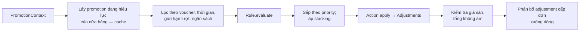

# Promotion

> Trạng thái: **Partially Implemented**. Theo [ADR-028](../19-adr/ADR-028-single-store-brand-as-catalog.md), khuyến mãi thuộc phạm vi toàn cửa hàng; giới hạn theo brand (nếu có) là rule điều kiện, không phải data scope.
>
> **Đã có:** module `modules/Promotion`: `promotions` (phạm vi cửa hàng, priority, `exclusive`/`combinable`, cần voucher hay tự động, giới hạn lượt, ngân sách, khung giờ, `lock_version`), `promotion_rules` (rule của plugin), `vouchers` (mã chữ hoa duy nhất, giới hạn lượt, hết hạn, bật/tắt), `promotion_usages`; `PromotionEngine` (đánh giá chỉ đọc; `recordUsage` bằng UPDATE có điều kiện; `revertUsage` idempotent), action `percent_off` / `amount_off`, extension point `PromotionRule` / `PromotionAction`, giá sàn `VANI_PROMOTION_MAX_DISCOUNT_BP` (mặc định 50%), Admin khuyến mãi/voucher cấp cửa hàng, concurrency test voucher.
>
> **Khác thiết kế:** mỗi khuyến mãi **một action** (cột `action_type` + `action_config`). **Giới hạn hiện tại:** framework không có Admin tổng quát để cấu hình rule của từng plugin; rule cụ thể do plugin cung cấp ([commerce-kernel](../02-architecture/commerce-kernel.md)).

## 1. Trách nhiệm

| Core (`modules/Promotion`) | Plugin (ví dụ `vani.promotion-rules`) |
|---|---|
| Mô hình promotion: phạm vi, thời gian, ưu tiên, stacking, ngân sách, giới hạn lượt | Rule điều kiện cụ thể: BxGy, giảm theo **brand**/collection/danh mục, đơn đầu tiên, VIP, flash sale |
| Voucher: mã, sinh hàng loạt, giới hạn lượt, gán khách | Hành động đặc thù: tặng quà, đồng giá combo |
| `PromotionEngine`: đánh giá rule, áp action, chống chồng, phân bổ | Admin UI cho rule của plugin |
| Action primitive: `percent_off`, `amount_off` (trên dòng/đơn/phí ship) | |
| Ghi nhận sử dụng (usage) atomic, hoàn lượt khi huỷ đơn | |
| `PromotionCalculator` trong totals pipeline | |

Không viết từng loại khuyến mãi vào Order/Checkout service (rule R1).

## 2. Contract

```php
namespace Modules\Promotion\Contracts;

interface PromotionRule
{
    public function type(): string;                                  // 'buy_x_get_y', 'first_order', ...
    public function configSchema(): array;                           // JSON Schema cho Admin
    /** Trả về các dòng đủ điều kiện (rỗng = không áp dụng) */
    public function evaluate(PromotionContext $context, RuleConfig $config): Eligibility;
}

interface PromotionAction
{
    public function type(): string;                                  // 'percent_off', 'amount_off', 'free_gift'...
    public function configSchema(): array;
    /** @return list<AdjustmentData> — luôn là Money, luôn ≤ 0 với giảm giá */
    public function apply(PromotionContext $context, Eligibility $eligibility, ActionConfig $config): array;
}

final readonly class PromotionContext
{
    public function __construct(
        public ?CustomerData $customer,       // null = khách vãng lai
        public CartSnapshot $cart,            // dòng, giá, brandId, collection, category của từng dòng (brand là thuộc tính catalog)
        public Money $subtotal,
        public ?Money $shippingFee,
        public array $voucherCodes,
        public CarbonImmutable $now,
        public array $attributes = [],        // plugin bổ sung qua hook (ví dụ mã giới thiệu, UTM)
    ) {}
}
```

## 3. Dữ liệu (Core)

```
promotions(id, name, status, starts_at, ends_at, priority, stacking[exclusive|combinable],
           requires_voucher, action_type, action_config, usage_limit NULL, usage_count,
           budget_amount NULL, budget_used_amount, lock_version)
promotion_rules(promotion_id, rule_type, config json)          -- rule_type do plugin đăng ký
vouchers(id, promotion_id, code UNIQUE, usage_limit, used_count, expires_at, status)
promotion_usages(promotion_id, voucher_id NULL, order_id, customer_id NULL, discount_amount, status[applied|reverted])
```

Nếu một `rule_type` thuộc plugin đang bị tắt thì promotion đó **không áp dụng** (engine bỏ qua và ghi log), không gây lỗi.

## 4. Flow đánh giá



- **Stacking**: `exclusive` có priority cao nhất thắng và dừng; `combinable` cộng dồn theo thứ tự priority, mỗi action tính trên giá **sau** action trước.
- **Giá sàn**: tổng giảm của một dòng không vượt `max_discount_bp` của cửa hàng (cấu hình cửa hàng 5000 = 50%, phù hợp quy định KM VN; Core không cấu hình = không giới hạn — [vietnam-localization §6](vietnam-localization.md)).
- Kết quả lưu vào `order_adjustments` (snapshot: mã promotion, tên, số tiền, dòng áp dụng).

## 5. Transaction và concurrency

- Đánh giá khi xem giỏ/checkout: **không** ghi gì.
- Trong `PlaceOrder`: đánh giá lại → `promotion_usages` insert + `vouchers.used_count` tăng bằng `UPDATE … SET used_count = used_count + 1 WHERE id = ? AND (usage_limit IS NULL OR used_count < usage_limit)`; không có dòng nào được cập nhật thì báo lỗi `promotion.voucher_exhausted` và rollback.
- Ngân sách: tương tự, `budget_used_amount + x <= budget_amount` trong câu `UPDATE` có điều kiện.
- Flash sale đông khách: cổng chặn Redis counter trước.
- `OrderCancelled` → usage `reverted`, trả lượt voucher (idempotent theo `order_id`).
- **Huỷ một phần (0.3.31)**: `adjustUsage` đưa `promotion_usages.discount_amount` + ngân sách về giảm giá còn trên đơn. Khách bớt hàng → `recheck` (chỉ rule đánh dấu `CartContentRule`, áp lại action theo thứ tự đã áp, không xét trạng thái/lượt/ngân sách hiện tại) để Ordering thu hồi phần không còn đủ điều kiện ([order §2.1](../09-order/order.md)). Rule plugin chỉ phụ thuộc dòng hàng nên `implements CartContentRule`; rule phụ thuộc lịch sử khách/thời điểm/nguồn thì không.

## 5.0 Action theo ngữ cảnh và khuyến mãi do plugin quản lý (Implemented)

- `ContextualPromotionAction` (mở rộng `PromotionAction`): `applyInContext(PromotionContext, $remaining, $config)` nhận số lượng, đơn giá và sản phẩm của từng dòng. Evaluator và `recheck()` gọi hàm này thay cho `apply()`; kết quả vẫn bị kẹp theo số tiền còn lại và giá sàn.
- `ManagedPromotions`: plugin tạo/cập nhật khuyến mãi qua `sync(owner, key, ManagedPromotion)`, cùng validate rule/action, audit, lock version như Admin. Cột `promotions.managed_by`, `managed_key`, `managed_route`. Admin → Khuyến mãi hiện nhãn "Plugin", form chỉ xem, không xoá được; `remove()` xoá khi chưa có lượt dùng, đã dùng thì chuyển sang tắt để giữ lịch sử đơn.
- Tham chiếu: `vani.bundles` — mỗi combo là một khuyến mãi cộng dồn với rule `bundle_complete` (`CartContentRule`) và action `bundle_percent` (giảm cho số bộ đủ món, SKU rẻ nhất trước).

## 5.1 Campaign (Implemented, 0.3.36)

Campaign gói **khuyến mãi + bảng giá sale/thành viên** chạy chung một lịch (vd. "Sale 11.11"). Admin → Khuyến mãi → Campaign.

- `campaigns` (mã, tên, `starts_at`/`ends_at`, `status` `draft`/`active`/`stopped`); `promotions.campaign_id`; `campaign_price_lists` (bảng giá thuộc tối đa một campaign).
- **Campaign sở hữu lịch:** khi lưu/kích hoạt/dừng, lịch và trạng thái được ghi xuống từng thành viên — khuyến mãi trực tiếp, bảng giá qua `Pricing\Contracts\PriceListSchedule` (không gắn được bảng giá `base`). Thành viên tự kiểm tra khung giờ khi tính giá/khuyến mãi, không có job định kỳ.
- Nháp → thành viên tắt. Kích hoạt → bật theo lịch (trạng thái hiển thị: Sắp chạy / Đang chạy / Đã kết thúc). **Dừng ngay** → mọi thành viên tắt tức thì, campaign không sửa/bật lại được. Chỉ xoá được campaign nháp (thành viên được tách ra).
- Gắn bảng giá cần thêm quyền `pricing.manage`; người chỉ có `promotion.manage` sửa campaign không đụng danh sách bảng giá.
- **Báo cáo** trên trang campaign: số đơn dùng khuyến mãi của campaign, doanh thu (`OrderStatistics::summarize`), tổng giảm khuyến mãi, số khách, đơn huỷ. Chưa tính: đơn chỉ hưởng giá sale của bảng giá campaign mà không dùng khuyến mãi (dòng đơn chưa lưu nguồn bảng giá).
- Tách thành viên khỏi campaign không đổi trạng thái của thành viên đó.

## 5.2 Lượt mỗi khách, mã riêng, giảm tối đa, trần theo giá gốc (Implemented, 0.5.109)

- **Lượt mỗi khách:** `promotions.usage_limit_per_customer`. Bộ đếm `promotion_customer_usages(promotion_id, customer_id, used_count)` luôn được ghi khi đơn có khách (kể cả khuyến mãi chưa giới hạn, để đặt giới hạn về sau tính đúng); tăng bằng `UPDATE … WHERE used_count < limit` trong `recordUsage`, hoàn trong `revertUsage`. Ở giỏ khách vãng lai chưa xác định nên chưa chặn; lúc đặt đơn Checkout đã giải khách theo SĐT nên đánh giá lại sẽ bỏ mã (`customer_limit`, ADR-044 §6), còn hai đơn song song thì đơn sau rollback với `promotion.customer_limit_reached`.
- **Mã riêng:** `vouchers.customer_id` — chỉ khách đó dùng được; khách khác/chưa đăng nhập nhận `not_owner`. Contract `Vouchers` cho plugin phát mã (mã chào mừng, ví voucher). Admin hiện cột "Khách" (id; tên do plugin hiện).
- **Giảm tối đa:** `percent_off.max_amount` kẹp tổng giảm của khuyến mãi, chia lại theo tỷ trọng dòng.
- **Trần theo giá gốc:** `PromotionLine::$compareAt` (giá gạch khi dòng có giá từ bảng giá sale/thành viên hoặc giá gốc nhập tay). Trần của dòng = `max_bp × giá gốc × số lượng`, trừ phần đã giảm bằng giá (giá gốc − giá bán) — flash sale −50% thì không giảm thêm khi trần 50%. Dòng không có giá gạch: như cũ.
- **Giải thích:** rule implement `ExplainsIneligibility` trả `Ineligibility` (câu, số tiền thiếu); voucher bị từ chối vì rule đó mang `hint`/`shortfall`. Storefront trả `message` = gợi ý hoặc câu theo lý do.
- **Xem trước mã:** `Checkout\Contracts\VoucherPreview::forCart()` chạy totals pipeline cho từng mã (tối đa 50), cùng khuyến mãi tự động; dùng cho ví voucher của `vani.coupon-code`.

## 5.3 Lịch lặp theo tuần (Implemented, 0.5.116)

Khuyến mãi, bảng giá sale/thành viên và campaign có thêm **lịch lặp** (`WeeklySchedule`): tối đa 3 khung, mỗi khung là các ngày trong tuần + giờ bắt đầu/kết thúc theo giờ cửa hàng, luôn nằm trong khoảng bắt đầu–kết thúc của đối tượng. Ví dụ "Sale cuối tuần tháng 12" = 01/12–31/12 + khung T7, CN 00:00–00:00; "Giờ vàng" = khung mọi ngày 12:00–14:00. Campaign ghi lịch lặp xuống thành viên. Cache trang hết hạn ở mốc mở/đóng kế tiếp.

## 6. Ví dụ plugin rule

```php
namespace Plugin\PromotionRules\Rules;

final class FirstOrderRule implements PromotionRule
{
    public function __construct(private OrderReader $orders) {}

    public function type(): string { return 'first_order'; }

    public function configSchema(): array
    {
        return ['type' => 'object', 'properties' => []];
    }

    public function evaluate(PromotionContext $ctx, RuleConfig $config): Eligibility
    {
        if ($ctx->customer === null) {
            return Eligibility::none();
        }
        $hasOrders = $this->orders->customerHasCompletedOrder($ctx->customer->id);

        return $hasOrders ? Eligibility::none() : Eligibility::wholeCart($ctx->cart);
    }
}
```

### 6.1 Rule "thuộc brand"

Rule `in_brands` (plugin `vani.promotion-rules`, Implemented) nhận danh sách slug thương hiệu, trả `Eligibility` gồm các dòng thuộc thương hiệu được chọn. Ví dụ "giảm 20% toàn bộ Urbanx" = promotion tự động + rule `in_brands` + action `percent_off`. Không cần phạm vi brand trong Core.

## 7. Kiểm thử

- Unit: engine với rule/action giả, stacking, giá sàn, phân bổ (bảo toàn tổng).
- Contract test cho `PromotionRule`/`PromotionAction` (plugin phải pass).
- Concurrency: 100 request dùng voucher `usage_limit = 10` → đúng 10 đơn thành công.
- Feature: huỷ đơn hoàn lượt voucher đúng một lần.
