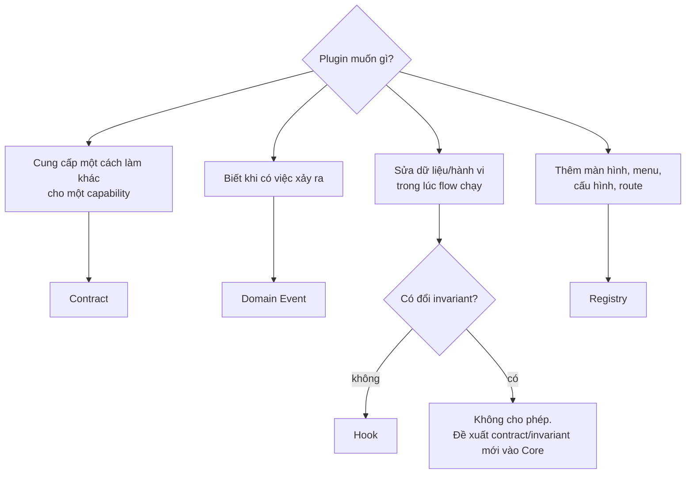

# Extension Model

> Trạng thái: **Partially Implemented**. Đã có: `Hook` (filter/action/collect/slot), registry `hooks.php`, strict mode, public/internal, cô lập lỗi ở slot, listener gắn với plugin và chỉ chạy khi plugin active, **kiểm tra kiểu trả về của filter** (strict: exception; production: bỏ kết quả sai + log), **đo thời gian listener theo hook × plugin** (`HookManager::timings()`, log cảnh báo khi > 50 ms), contract test suite. Theme `vani-base` dùng các slot storefront đã khai báo. Chưa có: xuất metric `hook_duration_ms` ra hệ thống giám sát. Quyết định: [ADR-004](../19-adr/ADR-004-extension-points.md). Chữ ký chính xác cho người viết plugin: [05-plugin/contracts](../05-plugin/contracts/README.md).

Extension Points là **API quan trọng nhất của VaniShop**: VaniShop là một microkernel thương mại ([ADR-029](../19-adr/ADR-029-commerce-microkernel.md)), nghiệp vụ — kể cả mặc định COD, phí ship, VAT — được xây ngoài Core qua extension point ([commerce-kernel](../02-architecture/commerce-kernel.md)). Danh mục cụ thể: [extension-point-catalog](extension-point-catalog.md); extension point còn thiếu theo plugin dự kiến: [§7 của catalog](extension-point-catalog.md); thiết kế mở rộng theo đợt: [ADR-030](../19-adr/ADR-030-extension-surface-v2.md).

| Ai cung cấp extension point | Ở đâu | Ai dùng |
|---|---|---|
| Microkernel (vòng 0) | `Extension`: registry tag, hook bus, `onEvent`, registry Admin/route/settings/schedule | Core, plugin |
| Commerce Core (vòng 1) | `modules/<Ctx>/Contracts`, `Events`, `hooks.php` | Plugin hệ thống, plugin nghiệp vụ |
| Plugin (vòng 2–3) | `Plugin\<Name>\Contracts`, `Events`, `custom/plugin/<Name>/hooks.php` (Designed) | Plugin khác, khai báo `requires.plugins` |

## 1. Bốn cơ chế

| Cơ chế | Bản chất | Dùng khi | Ví dụ |
|---|---|---|---|
| **Contract** | Interface + DTO, plugin đăng ký implementation (tag container) | Capability **thay thế được**, có nhiều implementation song song, Core chọn theo cấu hình/scope | `PaymentGateway`, `ShippingCarrier`, `PromotionRule`, `TaxCalculator` |
| **Domain Event** | DTO bất biến phát **sau khi** việc đã xảy ra (sau commit) | Phản ứng phụ, **không** thay đổi kết quả của flow đang chạy | `OrderPlaced` → gửi ZNS, cộng điểm, webhook |
| **Hook** (filter/action/slot) | Điểm có tên trong flow, cho plugin sửa dữ liệu hoặc chèn hành vi/UI | Cần **can thiệp vào flow đang chạy** nhưng không thay thế cả capability | `vani.checkout.before_validate`, `vani.storefront.pdp.after_price` |
| **Registry** | Khai báo tĩnh qua `PluginServiceProvider` | Đăng ký thứ để Core **hiển thị/nạp**: menu, trang Admin, permission, settings, route, scheduled task | `adminMenu()`, `settingsSchema()` |

### Chọn cơ chế



## 2. Khi nào KHÔNG được mở rộng

Các điểm sau **không có** extension point, và sẽ không bao giờ có:

- Bảng chuyển trạng thái đơn, thanh toán, fulfillment. Plugin chỉ **yêu cầu** chuyển qua `OrderTransitions`.
- Công thức ATS và logic khoá reservation. Plugin chỉ điều chỉnh qua `InventoryStrategy`, và kết quả luôn ≤ công thức gốc. Ngoại lệ duy nhất có kiểm soát: hạn mức đặt trước `BackorderPolicy` ([ADR-047](../19-adr/ADR-047-backorder-incoming-stock.md)) — Core tự áp ở kho bù tồn, plugin chỉ trả con số hạn mức.
- Kiểu `Money`, làm tròn cuối cùng của tổng đơn.
- Kiểm tra quyền, xác thực, chữ ký webhook.
- Nội dung snapshot đơn sau khi tạo.
- Ghi ledger (movement, audit, order events) theo kiểu append-only.

## 3. Public và Internal

| Loại | Nhận diện | Cam kết |
|---|---|---|
| **Public** | Namespace `Modules\<Ctx>\Contracts\*`, `Modules\<Ctx>\Events\*`; hook có trong `hooks.php` với `visibility: public`; registry của `PluginServiceProvider` | Theo compatibility policy (§5) |
| **Internal** | Mọi thứ khác: `Domain`, `Application`, `Persistence`, `Infrastructure`, hook `visibility: internal` | Có thể đổi bất kỳ lúc nào. Plugin dùng internal sẽ bị arch test chặn (rule R5) |

## 4. Hook

### 4.1 Quy ước tên

```
vani.<context>.<subject?>.<moment>
moment ∈ before_<verb> | after_<verb> | <noun> (filter dữ liệu) | slot UI
```

Khai báo theo mẫu: khoá `'vani.admin.page.*'` bao mọi hook có tiền tố đó (khai báo đúng tên được ưu tiên). Thêm `stability` (`stable`/`experimental`) và `on_error` (`fail`/`skip`) khi cần.

| Loại | Ví dụ | Trả về |
|---|---|---|
| filter | `vani.catalog.listing.query`, `vani.integration.order_payload` | Giá trị đã sửa (cùng kiểu) |
| action | `vani.order.after_create` | `void` |
| validate | `vani.checkout.before_validate` | Danh sách lỗi (`ValidationIssue[]`) |
| slot | `vani.storefront.pdp.after_price` | **Một** phần tử: dữ liệu có cấu trúc (Admin) hoặc view component (storefront); chỉ nối thêm ([ADR-025](../19-adr/ADR-025-native-storefront-ssr-slots.md)) |

### 4.2 API

```php
use Modules\Extension\Facades\Hook;

// Core công bố
$query   = Hook::filter('vani.catalog.listing.query', $query, $context);
$issues  = Hook::collect('vani.checkout.before_validate', $checkout);   // gộp lỗi từ mọi listener
$cards   = Hook::slot('vani.admin.dashboard.cards');                  // listener lỗi bị bỏ qua, có log
Hook::action('vani.order.after_create', $orderData);

// Plugin đăng ký trong boot() qua helper của PluginServiceProvider (gắn plugin id → chỉ chạy khi plugin active)
$this->onFilter('vani.integration.order_payload',
    fn (array $payload, OrderData $order): array => $payload + ['gift_wrap' => true],
    priority: 110);   // > 100 (mặc định) → chạy sau listener mặc định
// Tương tự: onAction(), onValidate() (trả list lỗi), onSlot() (trả một phần tử UI)
```

Cú pháp ngắn ([ADR-031](../19-adr/ADR-031-short-hook-syntax-auto-points.md)) — gọi được ở mọi nơi, vẫn đi qua HookManager:

```php
$data = vani_filter('vani.catalog.product.view_data', $data, $product);   // Core
vani_action('vani.order.after_create', $order);

// Trong plugin (vd. boot()): listener tự gắn với plugin theo vị trí file → tắt plugin là tắt listener
vani_add_filter('vani.admin.page.ordering.orders.show', fn (array $props): array => [...$props, 'myPlugin' => [...]], 110);
vani_add_action('vani.order.after_create', fn (PlacedOrder $order) => ...);
vani_add_slot('vani.storefront.pdp.after_price', fn (array $product) => new HtmlString('…'));   // 0.3.54
```

Các helper hook duy nhất là `vani_filter()`, `vani_action()`, `vani_add_filter()`, `vani_add_action()` và `vani_add_slot()`; tất cả đi qua HookManager. Helper đăng ký có priority mặc định `HookManager::DEFAULT_PRIORITY` = **100**.

**Dò luồng hook** (0.3.54): `VANI_HOOKS_TRACE=true` (mặc định theo `APP_DEBUG`) ghi log debug mỗi lần gọi hook — `Hook <loại>: <tên>` kèm danh sách plugin đang nghe (`core` = Core). Rất nhiều dòng (mỗi view/trang Admin có điểm tự động); tắt khi không cần. Production (`APP_DEBUG=false`) mặc định tắt.

### 4.2a Điểm mở rộng tự động (`experimental`)

| Họ hook (khai báo mẫu) | Ở đâu | Tham số |
|---|---|---|
| `vani.admin.page.*` | Props của mọi trang Admin (Inertia); tên = component viết thường, `::`/`/` → `.` | `(props, component)` |
| `vani.storefront.view.*` | Dữ liệu mọi view theme (`theme::pages.product` → `…view.pages.product`) | `(data, view)` |
| `vani.api.storefront.*` | Body JSON thành công của Storefront API (`products.show`, route plugin `x.<slug>.<tên>`) | `(body, request)` |

Chỉ chạy khi có listener; listener lỗi bị bỏ (`on_error: skip`); filter vẫn kiểm kiểu. `experimental` = có thể đổi ở bản minor (ghi CHANGELOG); có contract/registry `stable` (StorefrontEnricher, `adminFormSection`…) thì dùng cái đó.

```blade
<x-vani::hook-slot name="vani.storefront.pdp.after_price" :product="$product" />
```

### 4.3 Khai báo (registry hook)

```php
// modules/Checkout/hooks.php
return [
    'vani.checkout.before_validate' => [
        'type' => 'validate', 'visibility' => 'public', 'since' => '0.1',
        'transaction' => true,   // chạy trong transaction đặt hàng
        'args' => ['request' => CheckoutRequest::class],
    ],
    'vani.service.checkout.quote' => [
        'type' => 'filter', 'visibility' => 'public', 'since' => '0.3.47',
        'on_error' => 'skip',    // điểm hiển thị: listener lỗi bị bỏ
        'args' => ['quote' => CheckoutQuote::class, 'request' => CheckoutRequest::class],
    ],
];
```

- Gọi `Hook::filter/action` với tên **chưa khai báo** → exception ở môi trường local/test và bị CI chặn.
- `transaction: true` (0.5.65): hook có thể chạy **trong transaction DB**. Strict (local/test) báo `HookTransactionUndeclared` khi hook chạy trong transaction mà chưa khai — khai báo luôn khớp thực tế, plugin đọc khai báo là biết được gọi mạng hay không.
- `php artisan vani:plugin:hooks` liệt kê hook công khai, cột Transaction và plugin nào đang nghe.
- `php artisan vani:flows [checkout.place_order]` (0.5.65, học từ step list của Lunar 2.x): các bước của luồng theo thứ tự chạy thật — bước Core, calculator/validator (Core hay plugin nào, priority), hook kèm listener, bước nào trong transaction. Module mô tả luồng qua `Extension\Contracts\Flows`; thứ tự hook được test đối chiếu với lần chạy thật. Hiện có `checkout.quote`, `checkout.place_order`.

### 4.4 Quy tắc chạy hook

| Quy tắc | Lý do |
|---|---|
| Hook chạy **trong transaction** (khai `transaction: true`, ví dụ `vani.order.after_create`) chỉ được ghi DB của plugin, không I/O mạng, thời gian < 50 ms. Gọi HTTP qua HTTP client của Laravel trong transaction chưa commit bị `ExternalCalls` chặn (dev/test ném `ExternalCallInTransaction`, production ghi cảnh báo) — việc cần gọi mạng đẩy sang `vani.event.*` (sau commit) hoặc queue | Không kéo dài lock, không làm hỏng checkout; rollback không thu hồi được việc đã làm ở phía ngoài |
| Exception trong hook `validate`/`filter` của flow giao dịch → **fail flow** (rollback) | Rõ ràng hơn là bỏ qua lỗi âm thầm |
| Exception trong **slot UI** → bỏ qua slot đó, ghi log, trang vẫn hiển thị | Plugin lỗi không được làm sập storefront |
| Filter phải trả về **đúng kiểu** đầu vào; Core kiểm tra kiểu ở môi trường non-production | Chặn plugin trả dữ liệu sai |
| Thứ tự chạy theo `priority` (nhỏ chạy trước), cùng priority thì theo thứ tự nạp plugin | Có thể dự đoán |
| Mỗi lần gọi hook được đo thời gian theo hook × plugin; quá 50 ms thì log cảnh báo kèm plugin id (**Implemented**; xuất metric `hook_duration_ms{hook,plugin}`: chưa) | Phát hiện plugin chậm |
| Priority mặc định **100** cho mọi loại hook và mọi cách đăng ký (`HookManager::DEFAULT_PRIORITY`, 0.3.54; trước đó 10) | Cần chạy trước listener mặc định: < 100; chạy sau: > 100. Ghi tường minh khi thứ tự quan trọng |

## 5. Compatibility policy

"Public" ở đây là public **cho plugin nội bộ**: hiện không có plugin bên thứ ba và chưa làm plugin SDK ([ADR-033 mục 5](../19-adr/ADR-033-out-of-scope.md)). Policy dưới đây giữ để plugin nội bộ không vỡ khi Core đổi.

Extension point public được đánh version theo **SemVer của API cho plugin** — `vanishop.extension_api`, tách khỏi version Core từ 0.5.1 ([ADR-048](../19-adr/ADR-048-extension-api-version.md)). Chỉ class có `#[PluginApi]` (cùng hook, `PluginServiceProvider`, helper) tính là API cho plugin; phần còn lại của `Contracts`/`Events` là API giữa module:

| Thay đổi | Cho phép ở |
|---|---|
| Thêm contract/event/hook mới; thêm field **tuỳ chọn** vào DTO | Minor (1.x) |
| Thêm method vào **service contract** (Core implement, plugin chỉ gọi: `OrderReader`, `Carts`…) | Minor |
| Mở rộng **extension contract** (plugin implement: `PaymentGateway`, `NotificationChannel`…) bằng field tuỳ chọn trên DTO/capabilities, hoặc interface bổ sung tuỳ chọn mà Core kiểm tra bằng `instanceof` | Minor |
| Đổi tên, xoá, đổi kiểu tham số, **thêm method vào extension contract**, đổi ngữ nghĩa — phần `stable` | **Major**, sau khi đã `@deprecated` ít nhất 1 minor |
| Mọi thay đổi của phần `experimental` (`#[PluginApi(PluginApi::EXPERIMENTAL)]`, hook `stability: experimental`); `experimental` → `stable` | Minor |
| Sửa internal | Bất kỳ lúc nào |

- Extension contract có thể khai báo `REQUIRED` (`at_least_one`/`exactly_one`): Core từ chối tắt implementation cuối cùng (Designed, [commerce-kernel §5](../02-architecture/commerce-kernel.md)).
- Plugin khai báo `requires.extension_api: "^1.0"`. Loader từ chối bật plugin không tương thích (`incompatible_extension_api`) ([plugin-system](../05-plugin/plugin-system.md)). **Implemented** 0.5.1.
- Deprecation: class `#[PluginApi(deprecated: '…')]`, hằng/method `#[\Deprecated]` (PHP), hook khoá `deprecated` trong `hooks.php`. Plugin nghe hook deprecated → log `vani.deprecation`; `vani:plugin:doctor` cảnh báo `deprecated_usage` (quét tĩnh, kèm file:dòng). **Implemented** 0.5.2.
- Thực tế 0.4.x: một số thay đổi phá vỡ đã ra ở bản vá (0.4.21–0.4.27). Từ 0.5.1, mức tăng do `PluginApiSnapshotTest` kiểm tự động trên `extension_api`.
- **Giai đoạn dev — nâng cấp Core trước, plugin cập nhật sau (Owner 2026-11-18, nhấn mạnh 2026-11-20, [architecture-rules R38](../01-principles/architecture-rules.md), [ADR-048 — sửa đổi](../19-adr/ADR-048-extension-api-version.md)):**

  > **Khi phát triển, ưu tiên nâng cấp Core. Không cần giữ tương thích ngược với plugin hiện có. Plugin cập nhật sau.**

  Bảng trên chỉ áp khi `vanishop.extension_api_stage = stable`; hiện là `dev`:
  - Thay đổi phá vỡ phần `stable` (đổi constructor DTO, đổi/xoá method, tách interface, đổi kiểu) chỉ cần tăng **minor** + ghi CHANGELOG-extension (mục phá vỡ + mục **"Plugin cần cập nhật"**). Không `@deprecated` trước, không giữ API cũ song song, không adapter cho plugin cũ.
  - Commit Core giữ xanh bộ test Core; plugin trong `custom/plugin` cập nhật ở commit/đợt sau (suite `Plugins` được phép đỏ ở plugin chờ cập nhật). Plugin hệ thống mà test Core phụ thuộc (`vani.cod`, `vani.bank-transfer`, `vani.shipping-flat-rate`) phải còn chạy được.
  - Khi cập nhật plugin: tăng `version` của plugin (vá: chỉ dọn code; minor: đổi hành vi/cấu hình), xoá mục tương ứng khỏi "Plugin cần cập nhật".
  - Ví dụ: Payment abstraction 0.5.60–0.5.62 (Core trước) → plugin VNPay/VietQR/COD/chuyển khoản cập nhật ở commit sau.
- [`CHANGELOG-extension.md`](CHANGELOG-extension.md) ghi mọi thay đổi extension point. **Implemented** (0.2.0).
- **Version theo đợt việc** (Owner 2026-11-20, rà soát kiến trúc): `vanishop.version` (Core) tăng **một lần cho mỗi đợt việc** (một yêu cầu/một PR, có thể nhiều commit), không phải mỗi commit; CHANGELOG-extension ghi một mục cho đợt. `extension_api` vẫn tăng khi API cho plugin đổi (`PluginApiSnapshotTest` bắt buộc). Plugin đổi code (trừ `Tests/`, `*.md`) phải tăng `version` trong `vanishop.json` — `tests/Architecture/PluginVersionTest.php` so dấu vân tay code với `plugin-versions.snapshot`.
- `tests/Architecture/PluginApiSnapshotTest.php` chụp API cho plugin vào `plugin-api.snapshot` (header `Extension API x.y.z`): đổi mà không tăng `extension_api` đúng mức (xoá/đổi phần stable → major) + ghi "Extension API x.y.z" trong changelog thì CI đỏ. `PublicApiSnapshotTest` vẫn chụp toàn bộ `Contracts`, `Events`, `PluginServiceProvider` vào `public-api.snapshot` theo version Core. Không dùng abstract base cho contract — mở rộng extension contract theo hai cách ở bảng trên.

## 6. Kiểm thử

- **Contract test suite** do Core cung cấp: mỗi contract có một bộ test trừu tượng (ví dụ `PaymentGatewayContractTests`) mà plugin implement phải chạy và pass ([testing §6](../17-testing/testing.md)).
- Test hook: plugin giả lập trong `modules/Extension/Tests/Fixtures` (`FixturePlugins`) đăng ký filter/action và kiểm tra Core gọi đúng thời điểm, đúng kiểu.
- Arch test: plugin không dùng namespace internal của Core.
- Mỗi extension point public có implementation tham chiếu + contract test (rule R26).
