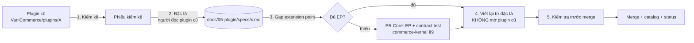

# Kế hoạch chuyển plugin VaniCommerce sang VaniShop

> Trạng thái: **Designed** (2026-10-14). Quyết định: [ADR-034](../19-adr/ADR-034-vanicommerce-plugin-migration.md). Phạm vi: chỉ chuyển **tính năng**; không chuyển dữ liệu từ DB VaniCommerce.

## 1. Nguồn và nguyên tắc

- Nguồn: 43 plugin trong `~/Ecommerce/VaniCommerce/plugins/`, Owner xác nhận thuộc quyền Owner (2026-10-14).
- Đích: `vanishop/custom/plugin/<Tên>`, id `vani.<tên>`, chỉ dùng API public của Core (R5).
- Không chép code, tên hook/bảng/class, cấu trúc file, header bản quyền hay comment. Được dùng lại: dữ liệu, nội dung và chuỗi hiển thị do Owner viết, ý tưởng nghiệp vụ.
- Plugin trùng thứ VaniShop đã có: không chuyển, chỉ đối chiếu tính năng còn thiếu (§3, nhóm A).

## 2. Quy trình cho từng plugin

| Bước | Việc | Đầu ra |
|---|---|---|
| 1. Kiểm kê | Liệt kê: tính năng, bảng dữ liệu, cấu hình, quyền, màn hình Admin, điểm hiển thị storefront, job/lịch, tích hợp ngoài, chuỗi/nội dung do Owner viết, phụ thuộc plugin khác | Phiếu kiểm kê (đầu file đặc tả) |
| 2. Đặc tả | Viết bằng lời: hành vi, quy tắc nghiệp vụ, dữ liệu (thiết kế bảng `plg_*` mới, không theo bảng cũ — [ADR-027](../19-adr/ADR-027-plugin-data-no-core-columns.md)), cấu hình, quyền, trường hợp lỗi, tiêu chí chấp nhận. Đối chiếu ADR-033, ADR-029 (Core hay plugin), luật VN | `docs/05-plugin/specs/<tên>.md` |
| 3. Gap EP | So đặc tả với [extension-point-catalog](../04-extension/extension-point-catalog.md). Thiếu thì thêm EP vào Core trước (contract + contract test + CHANGELOG), plugin là implementation tham chiếu (R26) | PR Core (nếu cần) |
| 4. Viết lại | Code mới từ đặc tả, theo [plugin-system](plugin-system.md) và [contracts](contracts/README.md); test feature + contract test | `custom/plugin/<Tên>` |
| 5. Kiểm tra | (a) Clean-room checklist; (b) grep chuỗi đặc trưng ([clean-room §6](../01-principles/clean-room-license.md)) và tên hook/bảng của plugin cũ trên plugin mới = 0; (c) so độ tương đồng plugin mới với plugin cũ (`jscpd`, ngưỡng 10 dòng) = 0; (d) suite + pint + phpstan xanh; (e) cập nhật [plugin-catalog](plugin-catalog.md), [status](../00-overview/status.md) | Commit trên `main` |

Mỗi plugin là một lát độc lập; không gộp nhiều plugin vào một lần merge.

## 3. Phân loại 43 plugin

### A. Đã có trong VaniShop — không chuyển, chỉ đối chiếu (16)

| Plugin cũ | Tương đương ở VaniShop | Đối chiếu |
|---|---|---|
| GdCashOnDeliver | `vani.cod` | Điều kiện hiện COD (ngưỡng, vùng) |
| OfflinePay | `vani.bank-transfer` | — |
| FlatShipping | `vani.shipping-flat-rate` | — |
| VnPay | `vani.vnpay` | — |
| MeiliSearch | `vani.search-meilisearch` | — |
| ProvincesVN | `vani.provinces-vn` (dữ liệu đã dùng lại) | — |
| MediaOptimizer | Core: ảnh thu nhỏ `public/cache`; `vani.media-webp` | Tạo sẵn thumbnail qua queue |
| FileManagerPro | Core: Thư viện ảnh dùng chung | Thao tác thư mục |
| CouponCode | Core: voucher (Promotion) | Gán mã cho khách, mã một lần |
| PricingCampaign | Core: bảng giá + campaign (0.3.36), giá thành viên (0.3.35) | Weekend sale, hot deal (lịch lặp) |
| PromotionInsight | Core: tầng giá trên đơn (0.3.37) + `vani.reports` | Báo cáo đơn bị giá sàn kẹp |
| ReturnExchange | Core: Returns (nhập lại tồn, thông báo, đổi hàng) | — |
| ProductSlug | Core: slug sản phẩm (Catalog) | Tự sinh slug không dấu từ tên |
| VariantColor | Core: Style → Màu (mã hex) | — |
| ZaloNotify | `vani.zalo-zns` | Nhật ký giao tin, danh sách chặn |
| ErpConnect | Core: Integration API v1 (đồng bộ delta, webhook, tồn theo SKU) | Connector ERP: đóng băng (roadmap Phase 9) |

### B. Chuyển sang — đủ extension point (16)

| Đợt | Plugin cũ | Plugin VaniShop | Extension point chính |
|---|---|---|---|
| **M1** (go-live) | PixelTracking | `vani.tracking-pixels` ([đặc tả](specs/tracking-pixels.md)) | Slot storefront, events đơn |
| M1 | SizeChart | `vani.size-chart` ([đặc tả](specs/size-chart.md)) | `adminFormSection` (product), slot PDP |
| M1 | FreeShippingProgress | gộp vào `vani.shipping-flat-rate` 1.1 ([đặc tả](specs/free-shipping-progress.md)) | Slot giỏ/checkout, `StorefrontEnricher` (cart) |
| M1 | Lookbook | `vani.lookbook` ([đặc tả](specs/lookbook.md)) | `storefrontPages`, `StorefrontBlock`, Thư viện ảnh |
| M1 | ExtraContent | gộp vào `vani.cms` 1.2 ([đặc tả](specs/store-content.md)) | `StorefrontBlock`, slot danh mục/brand |
| M1 | Bestseller | khối "Bán chạy" trong `vani.storefront-extras` ([đặc tả](specs/storefront-extras.md)) | `StorefrontBlock`, `OrderStatistics` |
| M1 | StorefrontBlocks (Core đã có khung `StorefrontBlock` + page builder; chuyển khối đã xem, video hero; trang hàng mới đã có) | `vani.storefront-extras` ([đặc tả](specs/storefront-extras.md)) | `StorefrontBlock`, Storefront API |
| **M2** | VnShipping (GHTK) | `vani.ghtk` | `ShippingCarrier` + `ShippingRateProvider` (mẫu `vani.ghn`) |
| M2 | OrderTracking | bổ sung `vani.ghn`/`vani.ghtk` + slot tra cứu đơn | Webhook/đồng bộ hãng, `shipment_events` |
| M2 | CodReconcile | `vani.cod-reconciliation` | Events fulfillment, `adminPages`, đối soát thanh toán |
| M2 | Social | `vani.social-login` | `AuthProvider` (W5b) |
| M2 | TwilioVerifyLogin | `vani.twilio-verify` | `OtpSender` |
| M2 | ProductQna | `vani.product-qna` | `storefrontRoutes`, slot PDP, `adminPages` |
| M2 | ReviewsPro | `vani.reviews` | `storefrontRoutes`, slot PDP, `OrderCompleted` (xác minh mua), Thư viện ảnh |
| M2 | ProductCompare | `vani.product-compare` | `storefrontPages`, slot thẻ sản phẩm |
| M2 | ScarcitySignals | `vani.scarcity-signals` | `StorefrontEnricher` (product), ATS public |

### C. Chuyển sang — cần thiết kế/extension point trước (6)

| Đợt | Plugin cũ | Plugin VaniShop | Cần gì trước |
|---|---|---|---|
| **M3** | LoyaltyPoints | `vani.loyalty` ([spec](specs/loyalty.md) đã có — đối chiếu bổ sung) | Dòng giảm/phí trong totals do plugin đóng góp (phụ thu W4a chưa làm), `accountPage` |
| M3 | BuyXGetY | `vani.promotion-advanced` | Action tặng sản phẩm (dòng quà 0đ) trong engine Promotion |
| M3 | OutfitBundle | `vani.product-bundle` + gắn sản phẩm lên ảnh `vani.lookbook` | Như BuyXGetY (giảm theo combo), giữ hàng cả bộ |
| M3 | PreOrder | `vani.pre-order` | **Quyết định thiết kế**: đặt trước không được phá bất biến "không bán vượt ATS" (R6) — cần chiều tồn "đặt trước" riêng hoặc đơn chưa giữ hàng |
| M3 | Workflow | `vani.workflow` | Đặc tả trigger/điều kiện/hành động trên domain event + `NotificationChannel`; quyền và giới hạn chạy |
| M3 | MarketingAutomation | `vani.marketing-automation` (dựng trên `vani.workflow`) | Consent marketing (Core có), phân khúc khách (0.3.35), `vani.workflow` |

### D. Chờ quyết định của Owner (5)

| Plugin cũ | Vấn đề | Đề xuất |
|---|---|---|
| WalletPay | Nhận nạp tiền vào ví có thể thuộc hoạt động trung gian thanh toán/ví điện tử cần giấy phép của NHNN | Chỉ làm "số dư cửa hàng" (hoàn tiền đổi/trả vào số dư, không nạp tiền), sau khi pháp chế xác nhận |
| Paypal, Stripe | Thanh toán quốc tế; cửa hàng hiện bán trong nước, tiền VND | Chỉ làm khi bán ra nước ngoài (`PaymentGateway` + `CapturesLater` đã có) |
| AkClear | Xoá cache từ Admin; VaniShop dùng `php artisan optimize` khi deploy | Không chuyển; nếu cần, một thao tác "Xoá cache" trong Admin → Hệ thống (Core) |
| Guard | Vá lỗ hổng riêng của lõi VaniCommerce | Không chuyển code; đối chiếu bốn lỗ với `vani:security:check` và [security](../15-security/security.md) để chắc VaniShop không mắc |

Tổng: 16 (A) + 16 (B) + 6 (C) + 5 (D) = 43.

## 4. Thứ tự và điều kiện xong

| Đợt | Nội dung | Xong khi |
|---|---|---|
| M0 | Đặc tả nhóm B đợt M1 + phiếu đối chiếu nhóm A | Đặc tả được Owner duyệt |
| M1 | 7 plugin storefront/nội dung phục vụ go-live | Mỗi plugin qua bước 5; E2E storefront có pixel, size chart, lookbook |
| M2 | Vận chuyển, đăng nhập, tương tác sản phẩm | Như trên; `vani.ghtk` chạy sandbox thật |
| M3 | Nhóm C, sau khi Core có extension point tương ứng | EP mới có contract test; plugin là implementation tham chiếu |
| — | Nhóm D | Theo quyết định của Owner |

Sau mỗi plugin: cập nhật bảng ở §3 (✅ + commit), [plugin-catalog](plugin-catalog.md), [status](../00-overview/status.md).

## 5. Đợt M0 — tiến độ

| Việc | Trạng thái |
|---|---|
| Đặc tả 7 plugin M1 (6 đặc tả: Bestseller gộp với StorefrontBlocks) | ✅ 2026-10-14, **chờ Owner duyệt** |
| Phiếu đối chiếu nhóm A (16 plugin đã có tương đương) | Chưa làm |

### 5.1 Khoảng trống Core phải làm trước M1 (một lát "M1-core")

Tổng hợp từ các đặc tả; làm theo [commerce-kernel §9](../02-architecture/commerce-kernel.md) (contract + contract test + CHANGELOG), mỗi mục có plugin M1 làm implementation tham chiếu.

| # | Khoảng trống | Dùng cho | Nơi sửa |
|---|---|---|---|
| G1 | Service contract thẻ sản phẩm theo danh sách id công khai (giống lưới Core) | storefront-extras (bán chạy, đã xem); lookbook M3 | Storefront |
| G2 | `GET /api/storefront/v1/products?ids[]=…` (tối đa 30, giữ thứ tự, chỉ hàng còn bán) | storefront-extras (đã xem) | Storefront |
| G3 | `OrderStatistics`: top style theo số lượng bán trong khoảng thời gian (trừ dòng huỷ) | storefront-extras (bán chạy) | Ordering |
| G4 | Tài nguyên Admin `category`, `brand` (`declareResource`) + form danh mục/thương hiệu render phần mở rộng | size-chart, store-content | Catalog + Admin Vue |
| G5 | Slot `vani.storefront.layout.body_start`, `vani.storefront.plp.before_listing` | store-content | Storefront `hooks.php` + theme `vani-base` |
| G6 | Theme phát sự kiện trình duyệt khi giỏ đổi (`vani:cart-updated`) | tracking-pixels | Theme `vani-base` |
| G7 | Kiểm tra: `settings()` nhận giá trị theo ngôn ngữ; `CatalogReader` trả danh mục chính + chuỗi danh mục cha | store-content, size-chart | Tenancy/Extension, Catalog |

Thứ tự đề xuất sau khi Owner duyệt: M1-core (G1–G7) → `vani.tracking-pixels` → `vani.shipping-flat-rate` 1.1 → `vani.size-chart` → `vani.lookbook` → `vani.cms` 1.2 → `vani.storefront-extras`.

## 6. Rủi ro

| Rủi ro | Kiểm soát |
|---|---|
| Plugin cũ chứa mã/chuỗi của bên thứ ba (header bản quyền, đoạn lấy từ plugin chính thức) | Không chép code (chỉ đặc tả); kiểm tra 5b, 5c trước merge |
| Đặc tả lẫn tên hook/bảng/class cũ | Review đặc tả: chỉ dùng thuật ngữ VaniShop ([glossary](../00-overview/glossary.md)) |
| Thiếu extension point → plugin chọc vào nội bộ Core | R5 (arch test); thiếu thì thêm EP vào Core trước (bước 3) |
| Tính năng phá bất biến (đặt trước, ví) | Nhóm C/D: quyết định thiết kế trước khi code |
| Plugin cũ có hạng mục ngoài phạm vi | Đối chiếu [ADR-033](../19-adr/ADR-033-out-of-scope.md) ở bước 2 (`ScopeTest` chặn trong docs/code) |
