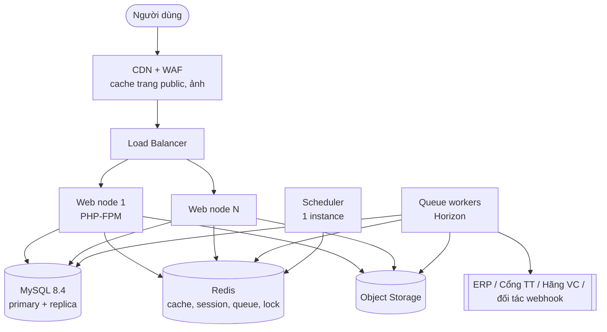

# Operations

> Trạng thái: **Designed**. Cài đặt, deploy và xử lý sự cố với mã nguồn hiện tại: [production](production.md). Hạ tầng tại Việt Nam ([ADR-018](../19-adr/ADR-018-infrastructure-vietnam.md)). Giám sát: [observability](../16-observability/observability.md). CI: [testing §8](../17-testing/testing.md).

## 1. Môi trường

| Môi trường | Mục đích | Dữ liệu | Tích hợp |
|---|---|---|---|
| `local` | Phát triển | Seeder/factory | Fake connector |
| `ci` | Test tự động | SQLite in-memory (unit) + MySQL 8.4 service (feature, concurrency) | Fake |
| `staging` | UAT, demo nghiệp vụ | Dữ liệu giả lập/ẩn danh | Sandbox ERP/cổng TT/hãng VC (ODO khi có) |
| `production` | Vận hành | Thật | Thật |

Không bao giờ copy dữ liệu khách production xuống môi trường thấp hơn nếu chưa ẩn danh hoá.

## 2. Kiến trúc triển khai



- **Toàn bộ hạ tầng và dữ liệu đặt tại Việt Nam** từ slice Foundation ([ADR-018](../19-adr/ADR-018-infrastructure-vietnam.md)): Viettel IDC, FPT Cloud, VNG Cloud, BizFly Cloud hoặc CMC Cloud (Owner chọn trực tiếp). Ưu tiên managed MySQL + object storage S3-compatible; Redis tự vận hành nếu không có managed. Không cần Meilisearch: tìm kiếm bằng truy vấn SQL (Owner, 2026-11-12).
- Triển khai bằng container (Docker), hạ tầng mô tả bằng mã (Terraform/Ansible) để có thể đổi nhà cung cấp.
- Backup khác vùng: 2 DC (Hà Nội ↔ TP.HCM).
- Web node **stateless**; session/cache ở Redis; file ở object storage.
- **Không dùng Laravel Octane** (Owner, 2026-11-27): web chạy Nginx + PHP-FPM, mỗi request một tiến trình sạch. Tải cao thì tăng web node, cache trang trong ứng dụng ([ADR-051](../19-adr/ADR-051-tagged-page-cache.md)) và CDN tuỳ chọn. Code vẫn giữ trạng thái theo request (scoped) đúng cho tiến trình phục vụ nhiều việc như queue worker, nhưng không thiết kế hay kiểm thử cho Octane.

## 3. Queue

Theo code (`config/horizon.php`, một supervisor, ưu tiên từ trên xuống):

| Queue | Công việc | Ưu tiên |
|---|---|---|
| `notifications` | Email/SMS/ZNS giao dịch (`SendNotificationJob`) | Cao nhất |
| `fulfillment` | Đẩy vận đơn lên hãng (`BookShipmentJob`) | Cao |
| `default` | Outbox tích hợp, việc tồn kho hàng loạt lớn (nhập file / sửa hàng loạt > 1.000 dòng — `ApplyStockChunkJob`, theo dõi ở bảng `job_batches`), việc khác | Trung bình |
| `search` | Cập nhật giá niêm yết thấp nhất trên danh sách (`SyncListPrices`) | Thấp |

IPN thanh toán xử lý ngay trong request callback; hàng giữ hết hạn và thanh toán quá hạn do lịch chạy mỗi phút (`vani:inventory:release-expired`, `vani:payment:expire`, `vani:payment:reconcile`), không qua queue. Tách queue riêng cho import/export lớn khi đo được nhu cầu.

Job phải **idempotent**, có `tries`, `backoff`, `timeout`; job tích hợp theo cùng aggregate dùng `WithoutOverlapping`/`ShouldBeUnique`.

## 4. Scheduler (tham khảo)

| Tần suất | Lệnh |
|---|---|
| Mỗi phút | Giải phóng reservation hết hạn; dispatcher outbox (bổ sung cho worker); kiểm tra thanh toán treo; ghi lượt xem sản phẩm từ cache xuống DB (`vani:catalog:flush-views`) |
| 5 phút | Health check connector; đồng bộ trạng thái vận đơn (fallback polling) |
| Hằng giờ | Kích hoạt/kết thúc khuyến mãi & bảng giá theo lịch; giỏ bỏ quên |
| Hằng đêm | Xoá ảnh đổi trả của yêu cầu đã đóng quá 90 ngày (`vani:returns:purge-attachments`, 03:45); snapshot tồn đối chiếu; chuyển điểm loyalty pending → available; hết hạn điểm; sitemap; feed sàn/quảng cáo; dọn log: `vani:integration:prune` (04:10, sự kiện/outbox đã gửi/inbox đã xử lý > `integration.retention_months`, mặc định 3), `vani:notification:prune` (04:20, > 6 tháng), `vani:audit:archive` (04:30, nhật ký thao tác > 24 tháng chuyển sang `audit_logs_archive`), `vani:catalog:flush-views --compact` (04:40, lượt xem theo giờ > 30 ngày gộp theo ngày). Nhật ký nghiệp vụ (`order_events`, `shipment_events`, `return_events`, `customer_consent_events`) không xoá |
| Hằng tháng | Xét hạng thành viên |

### 4.1 Bảng lớn: read replica và partition (db-refactor G3)

- **Read replica** (mặc định tắt): `DB_READ_HOST=host1,host2` → đọc từ replica, ghi vào `DB_HOST`, `sticky` (request vừa ghi đọc lại từ primary). Thống kê/báo cáo (`OrderStatistics`, plugin Reports) đọc qua kết nối `mysql_report` khi đặt `DB_REPORT_CONNECTION=mysql_report` + `DB_REPORT_HOST`. Màn hình cần số liệu tức thời (giữ hàng, checkout) luôn đọc primary trong transaction.
- **Partition** (chưa bật — làm khi `stock_movements` hoặc `price_history` vượt ~50 triệu dòng): hai bảng này append-only và không có khoá ngoại. Bảng partition không có FK và khoá chính phải gồm cột partition. Làm ngoài giờ cao điểm, sau khi sao lưu:

```sql
ALTER TABLE stock_movements DROP PRIMARY KEY, ADD PRIMARY KEY (id, created_at);
ALTER TABLE stock_movements PARTITION BY RANGE (TO_DAYS(created_at)) (
    PARTITION p2026_11 VALUES LESS THAN (TO_DAYS('2026-12-01')),
    PARTITION p2026_12 VALUES LESS THAN (TO_DAYS('2027-01-01')),
    PARTITION pmax VALUES LESS THAN MAXVALUE
);
-- Mỗi tháng: tách pmax thành tháng mới.
ALTER TABLE stock_movements REORGANIZE PARTITION pmax INTO (
    PARTITION p2027_01 VALUES LESS THAN (TO_DAYS('2027-02-01')),
    PARTITION pmax VALUES LESS THAN MAXVALUE
);
```

  Kiểm tra trước: `SELECT COUNT(*)` và truy vấn nóng có điều kiện `created_at` (EXPLAIN phải có `partitions: …` thu hẹp). Không dựng lại bảng có chỉ mục FULLTEXT (`products`) ngoài kết nối của ứng dụng: kết nối `mysql` tắt stopword (`innodb_ft_enable_stopword = OFF`); dựng lại bằng client khác thì đặt biến này trước.

## 5. Cache

- **Không cache từng sản phẩm hay thương hiệu.** Trang danh sách, tìm kiếm, bảng giá, lưới tồn đọc read model (`product_listing`, `product_facet_values`, `price_variant_index`, `stock_grid_index`) do projector cập nhật theo event — dữ liệu luôn đúng, không cần xoá cache.
- Cache theo khoá có phiên bản (không xoá hàng loạt): tổng số + facet trang danh sách `catalog:search:{phiên bản read model}:…` (600 giây, `ListingCacheVersion` tăng khi read model đổi); cài đặt cửa hàng `vani:settings:{phiên bản}:{namespace}` (`DatabaseSettings`: đổi phiên bản sau commit khi lưu cài đặt và sau `migrate`).
- Cache có hạn ngắn (chấp nhận trễ): số đơn của bước đã kết thúc (60 giây), dashboard kho (300 giây). Menu CMS (tươi 5 phút), sitemap (1 giờ), khối bán chạy (1 giờ) dùng `Cache::flexible`: quá hạn tươi thì vẫn trả bản cũ và một request tính lại sau khi trả response.
- **Admin → Cài đặt → Bộ nhớ đệm → Xoá cache** (quyền `settings.manage`, 0.5.104): như `php artisan cache:clear` — xoá store mặc định (cache trang, cài đặt, số đếm, menu, sitemap) và phát `PageCacheTagsInvalidated` toàn bộ cho CDN; giữ store `durable` và ảnh thu nhỏ; có audit `settings.cache_cleared`. Từ chối khi Redis cache dùng chung database với phiên/queue, hoặc `CACHE_DURABLE_STORE` trùng store mặc định. Chỉ xoá cache trang: Admin → Giao diện → Xoá cache trang.
- Khoá không có hạn tự nhiên (plugin đang bật, đường dẫn Admin, kết quả health plugin) có hạn 1 ngày làm lưới an toàn.
- **Hai store:** store mặc định (`CACHE_STORE`) chỉ chứa dữ liệu tính lại được — có thể là Redis allkeys-lru và được `cache:clear`. Dữ liệu tạm phải giữ tới khi hết hạn (token đăng ký, xác minh email, đặt lại mật khẩu, state đăng nhập mạng xã hội, bản xem trước khi nhập file sản phẩm/tồn/bảng kê COD, tiến độ thao tác hàng loạt) ở store `durable` (`Modules\Shared\Support\DurableCache`): mặc định bảng `cache_durable`, `cache:clear` không xoá, `vani:cache:prune-durable` (mỗi giờ) dọn dòng hết hạn. Muốn dùng Redis thì khai một store Redis **noeviction** rồi đặt `CACHE_DURABLE_STORE` — không trỏ vào instance allkeys-lru.
- Bộ đếm lượt xem sản phẩm cố ý ở store mặc định (không ghi DB mỗi lượt xem): cache bị xoá thì mất phần chưa ghi, thống kê gần đúng.
- **Cache trang công khai trong ứng dụng** ([ADR-051](../19-adr/ADR-051-tagged-page-cache.md), mặc định `VANI_PAGE_CACHE=app`): HTML trang chủ, danh mục, thương hiệu, sản phẩm, trang CMS lưu ở store mặc định (`vani:page:*`, ~50–150 KB mỗi trang đã xem), hạn tối đa 1 giờ (`VANI_PAGE_CACHE_APP_TTL`). Mỗi bản kèm phiên bản các tag dữ liệu đã dùng (`vani:page-cache:tag:*`); đổi dữ liệu → tag vào hàng đợi ở store `durable` → `vani:page-cache:invalidate` (scheduler, **mỗi phút**) đổi phiên bản. Khách thấy thay đổi sau tối đa ~1 phút; bảo trì, chế độ hiện giá, theme, nút **Admin → Giao diện → Xoá cache trang** (`vani:page-cache:invalidate --all`) áp dụng ngay. Chưa chạy cron thì request trang công khai tự chạy lô khi lô cuối quá 2 phút. Store `database`: `vani:cache:prune-durable` (mỗi giờ) dọn cả bảng `cache`. Đang sửa theme/view ở máy dev: đặt `VANI_PAGE_CACHE=off` hoặc chạy `--all` sau khi sửa (view đổi không làm đổi khoá cache tới khi đổi version/build).
- **Tự xoá ngay toàn bộ cache trang (0.5.107):** bật/tắt/nâng cấp/gỡ plugin; lệnh deploy `optimize`, `optimize:clear`, `view:cache`, `view:clear`, `config:cache`, `config:clear`, `cache:clear` chạy từ CLI (deploy sửa Blade không đổi version vẫn thấy ngay). Store cache lỗi (Redis mất kết nối): trang công khai vẫn phục vụ, không cache (`X-Vani-Cache-Reason: cache_error`, log cảnh báo một lần mỗi request). Lô xoá lỗi giữa chừng (store, plugin CDN): tag chỉ gỡ khỏi hàng đợi sau khi áp dụng xong, lô sau xoá lại.
- Có CDN (`VANI_PAGE_CACHE=cdn`): thêm `s-maxage` ngắn (300s) + `stale-while-revalidate` và header tag; chưa có plugin xoá CDN theo tag (L4).
- **Bật/tắt bảo trì storefront hoặc đổi chế độ hiện giá** (`core`/`storefront.maintenance`, `core`/`storefront.price_visibility`, [storefront §5](../14-storefront/storefront.md)): cache trong ứng dụng xoá ngay. CDN vẫn phục vụ bản đã cache tới khi hết `s-maxage` + `stale-while-revalidate` — sau khi đổi, **xoá cache CDN** của trang storefront (chưa có plugin xoá tự động). IPN cổng thanh toán và webhook vận chuyển vẫn chạy trong lúc bảo trì.

### Ảnh thu nhỏ (`public/cache`, 0.3.28)

- `Media::url($size, $group)` trỏ tới `/cache/media/{ab}/{checksum}-{kích thước}.{ext}`, kích thước `w400` (thu nhỏ giữ tỉ lệ), `w400h600c` (cắt khung — ảnh sản phẩm, tỉ lệ mặc định 2:3), `w600h900` (vừa khung). File có sẵn → web server trả tĩnh; chưa có → request rơi vào `index.php`, Laravel resize một lần (khoá file, ghi atomic; disk local đọc thẳng file gốc) rồi lưu lại. Chỉ kích thước trong cấu hình (0.3.87: **Admin → Thư viện ảnh → Kích thước ảnh** — bề rộng, tỉ lệ ảnh sản phẩm, chất lượng, kích thước có tên của plugin; mặc định theo `vanishop.media.cache.*`) và không phóng to mới được tạo (URL tuỳ ý → 404). Đổi kích thước = đổi URL, không cần xoá cache; nút "Xoá cache ảnh" dọn file cũ.
- Trong Thư viện ảnh, chọn một ảnh rồi mở **Điểm lấy nét**. Bản cắt theo nhóm ảnh sản phẩm có URL riêng cho điểm đã chọn. Khi đặt lại về giữa, hệ thống dùng URL cắt giữa mặc định.
- Nginx: location ảnh tĩnh phải fallback về Laravel, ví dụ `location /cache/ { try_files $uri /index.php?$query_string; expires 1y; }` — KHÔNG dùng `try_files $uri =404` cho `/cache/`.
- Định dạng: giữ như gốc; bật plugin `vani.media-webp` để xuất WebP. Đổi định dạng/chất lượng → `php artisan vani:media:cache --clear` (dọn file cũ; bản mới tự tạo dần) hoặc `--warm` để tạo trước sau deploy (bản cắt tỉ lệ sản phẩm chỉ tạo cho ảnh trong gallery sản phẩm).
- Nhiều app server: mỗi server có cache riêng (an toàn vì tên file theo checksum, nội dung không đổi); đặt CDN phía trước để giảm số lần resize.

## 6. Giám sát & cảnh báo

Xem [observability](../16-observability/observability.md) (log, metric, tracing, ngưỡng cảnh báo). Thêm synthetic check mỗi 5 phút cho: trang chủ, PDP, thêm giỏ, checkout COD với sản phẩm sandbox.

## 7. Triển khai (CI/CD)

1. PR → CI theo [testing §8](../17-testing/testing.md), build asset.
2. Merge `main` → deploy staging tự động → smoke test.
3. Release tag → deploy production **zero-downtime** — quy trình và lưu ý chi tiết: [production §5](production.md#5-quy-trình-mỗi-lần-deploy).
4. Feature flag (Laravel Pennant) cho tính năng lớn, bật theo nhóm khách/phần trăm lưu lượng.
5. Rollback: giữ artifact 5 bản gần nhất; migration theo expand/contract để rollback code không cần rollback DB.

## 8. Sao lưu & khôi phục

- MySQL: binlog (row-based) cho PITR giữ 14 ngày + snapshot/backup hằng ngày (Percona XtraBackup hoặc snapshot dịch vụ managed) giữ 35 ngày, lưu khác vùng.
- Object storage: versioning.
- **RPO ≤ 5 phút, RTO ≤ 2 giờ**; diễn tập khôi phục mỗi quý.
- Diễn tập tự động hoá bằng `php artisan vani:backup:drill [--fresh] [--disk=] [--keep]`: lấy bản backup mới nhất trên disk backup → giải nén dump (có mật khẩu nếu đặt) → nạp vào DB tạm `<db>_drill_<thời gian>` (không đụng DB đang chạy) → đối chiếu bảng `migrations` và số dòng các bảng nghiệp vụ chính với DB thật → xoá DB tạm → ghi kết quả vào `backup_drills` (bằng chứng). Mã thoát 1 nếu không đạt. Cảnh báo `backup.drill_stale` (production) khi không có lần đạt nào trong `VANI_ALERT_BACKUP_DRILL_DAYS` (100) ngày. Thời gian chạy (`duration_ms`) là số đo RTO phần DB.
- Dump dùng `--single-transaction` (snapshot InnoDB, không `LOCK TABLES`) — backup ban đêm không chặn ghi đơn hàng.

## 9. Chuẩn bị mùa cao điểm (11.11, 12.12, Tết)

- Load test (k6, `scripts/load/storefront.js`, overview §7) kịch bản flash sale trước 2 tuần: 3× tải dự kiến; nhớ xoá `VANI_LOAD_TEST_IPS` khỏi staging sau khi chạy. Kịch bản gồm: duyệt trang HTML + `/_vani/phien`; Storefront API (danh sách, chi tiết, gợi ý tìm kiếm, `/store`, beacon lượt xem cùng nguồn); đặt đơn COD (giỏ → thêm hàng → báo giá → đặt). Sau khi chạy: `vani:inventory:verify` (0 oversell, sổ tồn khớp).
- Số đo tham chiếu (2026-11-12, máy dev Herd, `APP_ENV=local`, dữ liệu demo, ApacheBench 5 kết nối song song, chỉ GET): `GET /products?per_page=24` p95 98 ms; `GET /products/{slug}` p95 70 ms; `GET /store` p95 30 ms; `GET /search/suggestions` p95 58 ms; trang chủ HTML p95 239 ms; trang sản phẩm HTML p95 44 ms; 0 lỗi. Trong NFR (API p95 < 200 ms, trang p95 < 300 ms) nhưng **chưa phải số liệu production**: một máy, không có tải ghi đồng thời, chưa đo luồng đặt đơn — đo lại bằng k6 trên staging cấu hình như production (Redis, opcache, `APP_DEBUG=false`).
- Pre-warm cache, tăng worker, tạm dừng job `bulk`.
- Flash sale: hàng đợi phòng chờ (waiting room) ở CDN nếu cần; counter tồn Redis.
- Đóng băng deploy (code freeze) 48h trước và trong sự kiện.
- **Safe mode plugin** (`VANI_PLUGINS_SAFE_MODE=true`) khi nghi plugin gây sự cố ([plugin-system §8](../05-plugin/plugin-system.md)).
- Runbook sự cố: cổng thanh toán lỗi (ẩn phương thức, ưu tiên COD), đối tác tích hợp/ERP chậm (outbox giữ message, không ảnh hưởng checkout), sự cố dữ liệu cá nhân.
